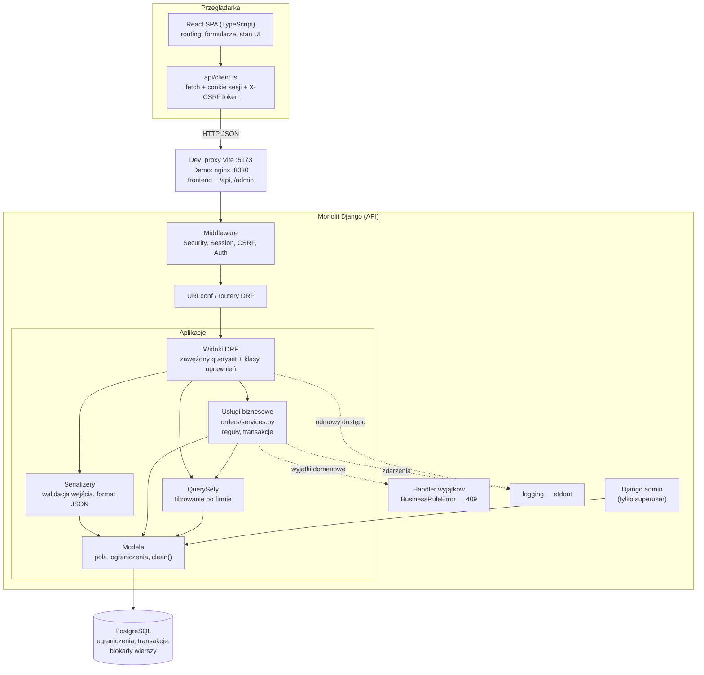
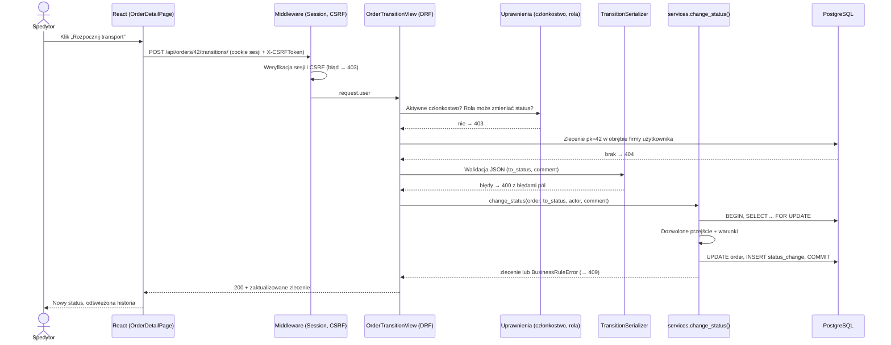
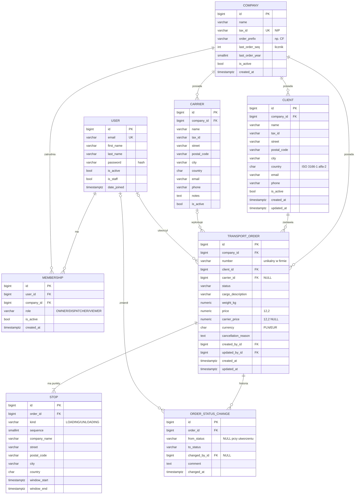
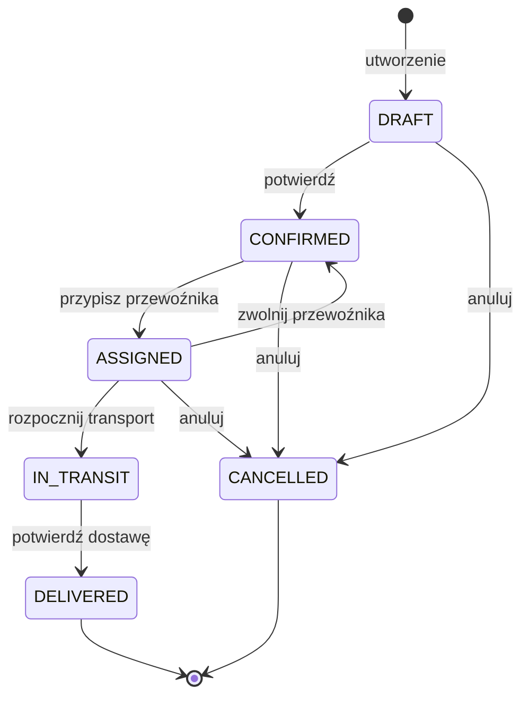
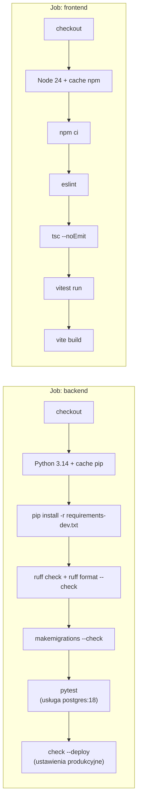
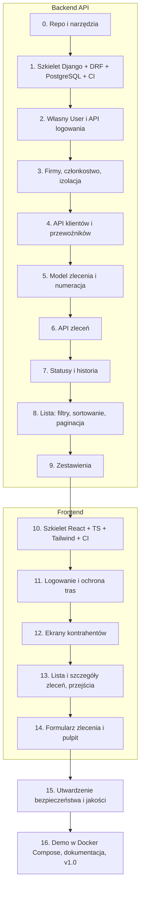

# CargoFlow — dokument projektowy MVP

> Wersja 0.2, 2026-10-18.
> Dokument nie zawiera kodu aplikacji. Fragmenty w blokach to diagramy, struktury katalogów i przykładowe komunikaty, nie implementacja.
> Wszystko oznaczone jako **[Założenie]** jest moją decyzją domyślną, którą możesz zmienić. Decyzje podjęte przez Ciebie są w sekcji 4.2.
>
> **Zmiany względem 0.1:** odpowiedzi na pytania P1–P5; frontend w React + TypeScript + Tailwind CSS zamiast Django Templates, więc backend staje się API (Django REST Framework, sesja + CSRF, jedno źródło pochodzenia, sekcja 5.7); wdrożenie publiczne zastąpione lokalnym demo w Docker Compose; nowy plan etapów: backend API, potem frontend, potem demo (sekcja 12).

## Spis treści

1. [Podsumowanie projektu i cel biznesowy](#1-podsumowanie-projektu-i-cel-biznesowy)
2. [Zakres MVP oraz elementy poza zakresem](#2-zakres-mvp-oraz-elementy-poza-zakresem)
3. [Wymagania funkcjonalne i niefunkcjonalne](#3-wymagania-funkcjonalne-i-niefunkcjonalne)
4. [Założenia i najważniejsze pytania otwarte](#4-założenia-i-najważniejsze-pytania-otwarte)
5. [Proponowany stack z uzasadnieniem](#5-proponowany-stack-z-uzasadnieniem)
6. [Architektura i struktura katalogów](#6-architektura-i-struktura-katalogów)
7. [Model danych i diagram ERD](#7-model-danych-i-diagram-erd)
8. [Najważniejsze reguły biznesowe](#8-najważniejsze-reguły-biznesowe)
9. [Model uprawnień](#9-model-uprawnień)
10. [Strategia testowania i bezpieczeństwa](#10-strategia-testowania-i-bezpieczeństwa)
11. [Workflow Git i CI](#11-workflow-git-i-ci)
12. [Plan implementacji z kolejnością etapów](#12-plan-implementacji-z-kolejnością-etapów)
13. [Kryteria akceptacji całego MVP](#13-kryteria-akceptacji-całego-mvp)
14. [Największe ryzyka i sposoby ich ograniczenia](#14-największe-ryzyka-i-sposoby-ich-ograniczenia)
15. [Rekomendowany następny krok](#15-rekomendowany-następny-krok)

---

## 1. Podsumowanie projektu i cel biznesowy

### Problem

Mała firma spedycyjna (5–30 osób) prowadzi zlecenia transportowe w arkuszach Excela, mailach i komunikatorach. Skutki:

- nie wiadomo, w jakim stanie jest zlecenie i kto je ostatnio zmienił;
- zdarzają się błędy: przewoźnik przypisany do anulowanego zlecenia, zlecenie „dostarczone” bez przewoźnika, zła cena;
- trudno policzyć, ile zleceń jest w realizacji i jaka jest marża w danym miesiącu;
- dane klientów i przewoźników są rozproszone i zduplikowane.

### Cel biznesowy

CargoFlow to wielofirmowa (multi-tenant) aplikacja webowa, w której spedytor:

1. prowadzi kartotekę klientów (zleceniodawców) i przewoźników;
2. tworzy zlecenie transportowe z miejscem załadunku i rozładunku, ładunkiem i ceną;
3. przypisuje przewoźnika i jego stawkę;
4. przeprowadza zlecenie przez kontrolowany cykl statusów;
5. widzi historię zmian statusów oraz proste zestawienia (liczba zleceń wg statusu, przychód, koszt i marża w miesiącu).

### Cel edukacyjny (równie ważny)

Projekt ma pokazać rekruterowi, że umiesz: zaprojektować model danych z ograniczeniami w bazie, odseparować dane firm, zaimplementować maszynę stanów z regułami biznesowymi i transakcjami, napisać testy uprawnień i logiki, pracować w Git z CI. Mała liczba funkcji, każda dopracowana i przetestowana, jest lepsza niż wiele funkcji „na pół gwizdka”.

### Słownik pojęć

| Pojęcie | Znaczenie w CargoFlow |
|---|---|
| Firma (Company) | Najemca systemu, czyli firma spedycyjna korzystająca z CargoFlow. Granica izolacji danych. |
| Członkostwo (Membership) | Powiązanie użytkownika z firmą wraz z rolą. |
| Klient (Client) | Zleceniodawca, który zamawia transport i płaci firmie. |
| Przewoźnik (Carrier) | Firma transportowa, która wykonuje przewóz na zlecenie spedytora. |
| Zlecenie (TransportOrder) | Zamówienie przewozu ładunku z punktu A do punktu B. |
| Punkt trasy (Stop) | Miejsce załadunku lub rozładunku z oknem czasowym. |
| Marża | Cena dla klienta minus koszt przewoźnika (netto). |

---

## 2. Zakres MVP oraz elementy poza zakresem

Ocena wstępnej listy funkcji z Twojej wiadomości:

| Obszar | Decyzja | Uzasadnienie |
|---|---|---|
| Użytkownicy, logowanie, wylogowanie | **MVP – konieczne** | Bez tego nie ma kontroli dostępu. Wbudowany `django.contrib.auth`. |
| Reset hasła mailem | MVP – opcjonalne | Wbudowany mechanizm tokenów resetu Django wywołany z API; w dev mail trafia do konsoli. Łatwe, ale niekrytyczne. |
| Samodzielna rejestracja firm | **Poza MVP** | Firmy i pierwszego właściciela tworzy administrator (Django admin lub komenda). Rejestracja to dodatkowe ryzyka (spam, weryfikacja). |
| Firmy i członkostwo z rolami | **MVP – konieczne** | Fundament izolacji danych i uprawnień. |
| Zapraszanie użytkowników przez właściciela | MVP – opcjonalne | W MVP właściciel może dodać członka przez prosty formularz lub admin dodaje go ręcznie. |
| Klienci i przewoźnicy (CRUD) | **MVP – konieczne** | Zlecenie bez nich nie ma sensu. |
| Zlecenia transportowe (CRUD bez usuwania) | **MVP – konieczne** | Rdzeń domeny. Zamiast usuwania – anulowanie. |
| Miejsca załadunku i rozładunku | **MVP – konieczne** | W MVP dokładnie jeden załadunek i jeden rozładunek, ale w osobnej tabeli, aby później dodać trasy wielopunktowe bez przebudowy. |
| Statusy i reguły przejść | **MVP – konieczne** | Najciekawsza część logiki biznesowej; świetny temat na rozmowę rekrutacyjną. |
| Historia zmian statusów | **MVP – konieczne** | Tabela `OrderStatusChange` zapisywana w tej samej transakcji co zmiana. |
| Pełny audyt zmian każdego pola | **Poza MVP** | Wymaga dodatkowej biblioteki (np. django-simple-history) lub sporo kodu. W MVP: `created_by`, `updated_by`, znaczniki czasu + historia statusów + logi aplikacji. |
| Filtrowanie, wyszukiwanie, sortowanie, paginacja | **MVP – konieczne** (lista zleceń) | Parametry w adresie (`?status=…&page=…`) + wbudowana paginacja DRF. Dla klientów/przewoźników wystarczy wyszukiwanie i paginacja. |
| Zestawienia | **MVP – minimalne** | Jedna strona: liczba zleceń wg statusu, przychód/koszt/marża w wybranym miesiącu. Agregacje ORM. |
| Eksport CSV | Wersja 1.1 | Prosty, ale nie jest potrzebny do pokazania kompetencji. |
| Dokumenty PDF (zlecenie dla przewoźnika) | Wersja 1.x | Wymaga biblioteki do PDF. |
| Wiele walut i przeliczanie kursów | **Poza MVP** | W MVP przechowujemy walutę (PLN/EUR), ale nie przeliczamy. Zestawienia liczone osobno dla każdej waluty. |
| API REST (DRF) | **MVP – konieczne** (zmiana w 0.2) | Frontend w React potrzebuje API JSON. Teraz jest to uzasadnione wymaganiem, więc DRF wchodzi do MVP. |
| Frontend React + TypeScript + Tailwind CSS | **MVP – konieczne** (zmiana w 0.2) | Twoja decyzja. Budujemy go po ustabilizowaniu API, jako osobną aplikację w katalogu `frontend/` tego samego repozytorium. |
| Panel Django admin | MVP – narzędzie operatora | Zostaje do tworzenia firm i właścicieli. Nie jest interfejsem dla użytkowników. |
| Lokalne demo w Docker Compose | **MVP – konieczne** (zmiana w 0.2) | Rekruter uruchamia całość jedną komendą, bez instalowania Pythona i Node. |
| Wdrożenie publiczne (serwer, domena, HTTPS) | **Poza zakresem** (zmiana w 0.2) | Twoja decyzja: aplikacja ma działać lokalnie. |
| Powiadomienia mailowe, zadania w tle | Poza MVP | Wymagałyby Celery/Redis; brak wymagań MVP. |
| Płatności, mapy, GPS, integracje z giełdami transportowymi, mikroserwisy | **Poza zakresem** | Zgodnie z Twoją wiadomością. |
| Portal dla klienta lub przewoźnika (zewnętrzny login) | Poza zakresem | Komplikuje model uprawnień; w MVP użytkownikami są wyłącznie pracownicy firmy spedycyjnej. |

---

## 3. Wymagania funkcjonalne i niefunkcjonalne

Oznaczenia: **M** = must (konieczne w MVP), **S** = should (opcjonalne w MVP, jeśli starczy czasu), **P** = przyszłe wersje.

### 3.1 Wymagania funkcjonalne

**Konta i dostęp (FR-ACC)**

| ID | Wymaganie | Priorytet |
|---|---|---|
| FR-ACC-1 | Użytkownik loguje się adresem e-mail i hasłem, wylogowuje się (POST). | M |
| FR-ACC-2 | Każdy widok aplikacji poza logowaniem wymaga zalogowania. | M |
| FR-ACC-3 | Użytkownik zmienia własne hasło. | M |
| FR-ACC-4 | Reset hasła przez e-mail (wbudowane widoki Django). | S |
| FR-ACC-5 | Użytkownik bez aktywnego członkostwa widzi stronę „brak dostępu do firmy” i nic więcej. | M |

**Firmy i członkostwo (FR-COM)**

| ID | Wymaganie | Priorytet |
|---|---|---|
| FR-COM-1 | Administrator systemu tworzy firmę i jej właściciela (Django admin lub komenda `manage.py`). | M |
| FR-COM-2 | Właściciel widzi listę członków firmy i ich role. | M |
| FR-COM-3 | Właściciel dodaje istniejącego/nowego użytkownika do firmy, zmienia rolę, dezaktywuje członkostwo. | S |
| FR-COM-4 | Firma musi mieć zawsze co najmniej jednego aktywnego właściciela. | M (jeśli FR-COM-3) |

**Kontrahenci (FR-PAR)**

| ID | Wymaganie | Priorytet |
|---|---|---|
| FR-PAR-1 | Dodawanie, edycja i podgląd klienta: nazwa, NIP, adres, kontakt. | M |
| FR-PAR-2 | Dodawanie, edycja i podgląd przewoźnika: jw. + uwagi. | M |
| FR-PAR-3 | Lista z wyszukiwaniem po nazwie/NIP i paginacją. | M |
| FR-PAR-4 | Archiwizacja (dezaktywacja) zamiast usuwania; zarchiwizowanego kontrahenta nie można wybrać w nowym zleceniu. | M |
| FR-PAR-5 | NIP unikalny w obrębie firmy dla danego typu kontrahenta. | M |

**Zlecenia (FR-ORD)**

| ID | Wymaganie | Priorytet |
|---|---|---|
| FR-ORD-1 | Utworzenie zlecenia w statusie Szkic: klient, ładunek, załadunek, rozładunek, cena dla klienta. | M |
| FR-ORD-2 | Automatyczny numer zlecenia unikalny w firmie, np. `CF/2026/00042`. | M |
| FR-ORD-3 | Edycja zlecenia zgodnie z regułami statusu (sekcja 8.3). | M |
| FR-ORD-4 | Przypisanie przewoźnika i jego stawki. | M |
| FR-ORD-5 | Zmiana statusu wyłącznie przez dozwolone przejścia (sekcja 8.1). | M |
| FR-ORD-6 | Anulowanie z obowiązkowym powodem. | M |
| FR-ORD-7 | Szczegóły zlecenia pokazują historię statusów (kto, kiedy, z jakiego na jaki, komentarz). | M |
| FR-ORD-8 | Lista zleceń: filtr po statusie, kliencie, przewoźniku, zakresie dat załadunku; wyszukiwanie po numerze i nazwie klienta; sortowanie po dacie utworzenia, dacie załadunku, numerze, cenie; paginacja 25 na stronę. | M |
| FR-ORD-9 | Zlecenia nie są usuwane z poziomu aplikacji. | M |
| FR-ORD-10 | Trasa wielopunktowa (wiele załadunków/rozładunków). | P |
| FR-ORD-11 | Kopiowanie zlecenia jako szablonu. | P |

**Zestawienia (FR-REP)**

| ID | Wymaganie | Priorytet |
|---|---|---|
| FR-REP-1 | Pulpit: liczba zleceń w każdym statusie. | M |
| FR-REP-2 | Dla wybranego miesiąca: przychód, koszt przewoźników i marża (zlecenia dostarczone), osobno dla każdej waluty. | M |
| FR-REP-3 | Top 5 klientów wg przychodu w miesiącu. | S |
| FR-REP-4 | Eksport CSV listy zleceń z aktualnymi filtrami. | P |

**API i interfejs (FR-API, FR-UI)** – dodane w 0.2

| ID | Wymaganie | Priorytet |
|---|---|---|
| FR-API-1 | Każda funkcja z FR-ACC, FR-PAR, FR-ORD i FR-REP jest dostępna przez API JSON pod `/api/`. | M |
| FR-API-2 | Spójny format błędów: walidacja → 400 z błędami pól; brak logowania lub uprawnień → 403; obcy lub nieistniejący obiekt → 404; naruszenie reguły biznesowej → 409 z kodem błędu. | M |
| FR-API-3 | `GET /api/auth/me/` zwraca użytkownika, firmę i rolę, żeby frontend mógł dopasować widok. | M |
| FR-API-4 | Dokumentacja API w formacie OpenAPI. | S |
| FR-UI-1 | Logowanie, wylogowanie, ochrona tras wymagających zalogowania. | M |
| FR-UI-2 | Ekrany: lista i formularz kontrahentów; lista zleceń z filtrami w adresie URL; szczegóły zlecenia z historią i przyciskami dozwolonych przejść; formularz zlecenia; pulpit. | M |
| FR-UI-3 | Błędy walidacji z API wyświetlane przy właściwych polach formularza. | M |
| FR-UI-4 | Akcje niedostępne dla roli (np. edycja dla Podglądu) są ukryte. To tylko wygoda, bo ochrona jest w backendzie. | M |
| FR-UI-5 | Widoczne stany ładowania, pustej listy i błędu sieci. | M |

### 3.2 Wymagania niefunkcjonalne

| ID | Kategoria | Wymaganie |
|---|---|---|
| NFR-1 | Bezpieczeństwo | Pełna izolacja danych firm: każde zapytanie o dane domenowe jest filtrowane po firmie z członkostwa użytkownika. Próba dostępu do obcego obiektu kończy się 404. |
| NFR-2 | Bezpieczeństwo | `manage.py check --deploy` bez ostrzeżeń dla konfiguracji produkcyjnej. Sekrety wyłącznie w zmiennych środowiskowych. |
| NFR-3 | Spójność | Zmiana statusu i wpis historii zapisują się atomowo. Kluczowe niezmienniki wymuszone również przez ograniczenia bazy. |
| NFR-4 | Testowalność | Testy uruchamiane jedną komendą lokalnie i w CI na PostgreSQL. Każda reguła biznesowa i każde uprawnienie ma test. |
| NFR-5 | Jakość kodu | Ruff (lint + format) bez błędów; CI blokuje merge przy błędzie. |
| NFR-6 | Wydajność | Lista zleceń wykonuje stałą liczbę zapytań SQL niezależnie od liczby wierszy na stronie (brak N+1; `select_related`). Strona listy < 300 ms przy 10 000 zleceń na lokalnym środowisku (orientacyjnie, bez przedwczesnej optymalizacji). |
| NFR-7 | Powtarzalność | Uruchomienie środowiska od zera: `git clone` + `docker compose up` + migracje, opisane w README. |
| NFR-8 | Utrzymywalność | Decyzje architektoniczne zapisywane jako krótkie ADR w `docs/adr/`. |
| NFR-9 | Czas i lokalizacja | Daty przechowywane w UTC (`USE_TZ = True`), wyświetlane w strefie `Europe/Warsaw`. Interfejs po polsku. |
| NFR-10 | Dostępność UI | Semantyczny HTML w komponentach React, formularze z etykietami, czytelne komunikaty błędów, obsługa klawiatury. Wygląd prosty: Tailwind bez gotowej biblioteki komponentów. |
| NFR-12 | Jakość frontendu | TypeScript w trybie `strict`, ESLint bez błędów, `tsc --noEmit` w CI, testy komponentów w Vitest. |
| NFR-13 | Uruchomienie demo | `docker compose -f compose.demo.yml up --build` na czystej maszynie z samym Dockerem daje działającą aplikację z danymi demo pod `http://localhost:8080`. |
| NFR-11 | Obserwowalność | Logi aplikacji w formacie tekstowym na stdout, bez haseł i danych wrażliwych; każda zmiana statusu i odmowa uprawnień logowana. |

---

## 4. Założenia i najważniejsze pytania otwarte

### 4.1 Założenia (przyjęte, dopóki nie zdecydujesz inaczej)

1. **[Założenie]** Użytkownikami są tylko pracownicy firm spedycyjnych. Klient i przewoźnik nie logują się do systemu.
2. **[Decyzja P1]** Model danych pozwala na członkostwo w wielu firmach (tabela `Membership`), ale **w MVP użytkownik należy do dokładnie jednej firmy** (ograniczenie unikalności na `user`). Usunięcie tego ograniczenia i dodanie przełącznika firmy to późniejsza, mała zmiana.
3. **[Założenie]** Klient i przewoźnik to dwa osobne modele ze wspólną klasą abstrakcyjną (uzasadnienie w 7.3).
4. **[Założenie]** Jedno zlecenie = jeden klient, jeden przewoźnik (opcjonalnie do momentu przypisania), jeden załadunek, jeden rozładunek.
5. **[Założenie]** Kwoty netto w PLN lub EUR, bez przeliczania walut i bez VAT. Waluta kosztu przewoźnika jest taka sama jak waluta ceny dla klienta (upraszcza marżę).
6. **[Założenie]** Zleceń, klientów i przewoźników nie usuwamy fizycznie z poziomu aplikacji: zlecenia anulujemy, kontrahentów archiwizujemy.
7. **[Decyzja P5]** Brak wdrożenia publicznego. Ostatni etap to lokalne demo w Docker Compose z konfiguracją zbliżoną do produkcyjnej (`DEBUG=False`, gunicorn, zbudowany frontend w nginx), które rekruter uruchamia u siebie.
8. **[Założenie]** Edycje zwykłych pól zlecenia: „ostatni zapis wygrywa” w MVP; zmiany statusu chronione blokadą wiersza. Optymistyczne blokowanie edycji formularza (pole `version`) jako rozszerzenie (patrz 8.6).
9. **[Decyzja]** Interfejs użytkownika to SPA w React + TypeScript + Tailwind CSS (sekcja 5.7). Django renderuje tylko panel admina.
10. **[Założenie]** Kolejność prac: najpierw kompletne i przetestowane API, potem frontend (uzasadnienie w 5.7).


### 4.2 Decyzje podjęte (2026-10-18)

| # | Pytanie | Decyzja | Konsekwencja |
|---|---|---|---|
| P1 | Czy użytkownik może należeć do kilku firm? | **Nie w MVP** | `UniqueConstraint(user)` na `Membership`; brak przełącznika firmy. |
| P2 | Trzy role: Właściciel, Spedytor, Podgląd? | **Tak** | Macierz 9.2 bez zmian. |
| P3 | Django 5.2 LTS czy 6.1? | **5.2 LTS** | Pełna zgodność z pytest-django i DRF. |
| P4 | `main` + `develop` czy GitHub Flow? | **`main` + `develop`** | Sekcja 11.3. |
| P5 | Wdrożenie publiczne? | **Nie, tylko lokalnie** | Etap końcowy: demo w Docker Compose (etap 16). |
| – | Frontend | **React + TypeScript + Tailwind CSS** | Backend jako API (DRF), narzędzia frontendowe, drugi job w CI (5.7, 11.6). |

### 4.3 Pytania otwarte

Brak pytań blokujących. Jedna drobna decyzja zapadnie przy etapie 12: kiedy przejść z ręcznego `fetch` na TanStack Query (rekomendacja w 5.7).

---

## 5. Proponowany stack z uzasadnieniem

### 5.1 Weryfikacja wersji (stan na 2026-10-18)

Sprawdzone w oficjalnych źródłach podczas przygotowania dokumentu:

| Komponent | Fakty | Źródło |
|---|---|---|
| Django | Najnowsze wydanie: 6.1.2. Wspierane serie: 5.2 LTS (najnowsza 5.2.18, wsparcie bezpieczeństwa do kwietnia 2028), 6.0 (do kwietnia 2027), 6.1 (do grudnia 2027). Następne LTS: 6.2, planowane na kwiecień 2027. | djangoproject.com/download |
| Django ↔ Python | 5.2: Python 3.10–3.14 (3.14 od 5.2.8). 6.0 i 6.1: Python 3.12–3.14. Python 3.15 nie jest jeszcze wspierany przez żadną wersję Django. | docs.djangoproject.com, FAQ instalacji |
| Python | 3.15.0 wydany 2026-10-09 (za świeży dla Django). 3.14 w fazie bugfix (3.14.8), wsparcie do 2030-10. | python.org/downloads |
| PostgreSQL | Wspierane 14–18; najnowsze 18.6 (wsparcie do listopada 2030). Django 6.1 wymaga PostgreSQL 15+. | postgresql.org/support/versioning |
| Sterownik | Django wymaga psycopg 3.1.12+ lub psycopg2 2.9.9+; psycopg2 ma być w przyszłości wycofany. | docs.djangoproject.com, „Databases” |
| pytest-django | 4.14.0 (2026-08-10); oficjalnie deklaruje Django 5.2 i 6.0 oraz Python 3.10–3.14. **Django 6.1 nie jest jeszcze wymieniony.** | pypi.org/project/pytest-django |
| Ruff | Najnowsza: 0.17.1. | pypi.org |
| Django REST Framework | 3.18.3 (2026-10-06); wspiera Django 5.2, 6.0, 6.1 i Python 3.10+. | pypi.org/project/djangorestframework |
| Node.js | Linie LTS: 24 (24.22.0) i 22 (22.23.3); 26 to „Current”, jeszcze nie LTS. | nodejs.org |
| Vite | 8.3.4; wymaga Node 20.19+ lub 22.12+. | registry.npmjs.org |
| React | 19.3.1 | registry.npmjs.org |
| React Router | 8.4.0; wymaga Node 22.22+. | registry.npmjs.org |
| TypeScript | Najnowszy to 7.0.2, ale typescript-eslint 8.71.2 deklaruje zgodność tylko z TypeScript < 6.1. Dlatego wybieramy **6.0.x** (najnowsza 6.0.3). | registry.npmjs.org |
| Tailwind CSS | 4.3.3 z wtyczką `@tailwindcss/vite` 4.3.3 (zgodna z Vite 5–8). | registry.npmjs.org |
| Vitest | 5.0.5; wymaga Vite 6–8 oraz Node 22.12+ lub 24+. | registry.npmjs.org |
| TanStack Query | 5.104.4 | registry.npmjs.org |

Nie weryfikowałem w dokumentacji: dokładnego wsparcia PostgreSQL 18 przez Django 5.2 (oczekuję, że działa, bo minimalna wersja dla 5.2 to 14, a nowsze wersje bazy są zwykle zgodne). Sprawdzimy to w praktyce na etapie 1 – testy CI na PostgreSQL 18 to rozstrzygną.

### 5.2 Rekomendacja wersji

| Komponent | Wersja | Dlaczego |
|---|---|---|
| Python | **3.14.x** | Najnowsza wersja wspierana przez Django, w pełnym wsparciu bugfix. 3.15 za nowy. |
| Django | **5.2.x LTS** (najnowsza łatka) | Długie wsparcie (do 04.2028) obejmuje cały okres rekrutacji; pełna zgodność z pytest-django; najwięcej materiałów i odpowiedzi na Stack Overflow. Alternatywa: 6.1 – nowsze funkcje, ale wsparcie kończy się w 12.2027 i pytest-django jeszcze jej nie deklaruje. Plan: po wydaniu 6.2 LTS (04.2027) wykonamy aktualizację jako osobne zadanie – to cenne doświadczenie do opowiedzenia na rozmowie. |
| PostgreSQL | **18.x** (obraz `postgres:18`) | Najnowsza wspierana wersja, najdłuższe wsparcie. Jeśli testy wykażą problem z Django 5.2, spadamy na 17. |
| psycopg | **3.x** (`psycopg[binary]`) | Zalecany przez Django; psycopg2 wycofywany. |
| Django REST Framework | **3.18.x** | Zgodny z Django 5.2. |
| Node.js | **24 LTS** | Najdłużej wspierana linia LTS; spełnia wymagania Vite, Vitest i React Router. Potrzebny tylko w dev i przy budowaniu obrazu demo. |
| TypeScript | **6.0.x** | Najnowsza wersja zgodna z typescript-eslint. Na TypeScript 7 przejdziemy, gdy narzędzia lintujące go oficjalnie obsłużą. |
| React / Vite / Tailwind CSS | **19.x / 8.x / 4.x** | Aktualne stabilne linie. Dokładne wersje przypnie `package-lock.json`. |

### 5.3 Technologie: uzasadnienie i alternatywy

| Technologia | Rola | Uzasadnienie | Odrzucone alternatywy |
|---|---|---|---|
| Python | Język | Cel rekrutacyjny. | – |
| Django | Framework | „Baterie w zestawie”: auth, admin, ORM, migracje, formularze, CSRF, szablony, testy. Dla aplikacji CRUD z uprawnieniami to najszybsza i najbezpieczniejsza droga. | Flask/FastAPI – trzeba samemu złożyć auth, migracje, formularze, CSRF; więcej decyzji i ryzyka dla początkującego. |
| PostgreSQL | Baza | Transakcje, `SELECT … FOR UPDATE`, ograniczenia CHECK i warunkowe UNIQUE, dobre wsparcie w Django; standard rynkowy. | SQLite – wygodny, ale słabsza współbieżność i inne zachowanie blokad; testy nie byłyby wiarygodne. MySQL – możliwy, mniej popularny w ekosystemie Django. |
| Django ORM | Dostęp do danych | Bezpieczne parametryzowane zapytania, migracje, agregacje wystarczą do zestawień. | Surowy SQL – tylko gdyby ORM nie wystarczał (w MVP nie przewiduję). SQLAlchemy – dublowałby ORM Django. |
| Django REST Framework | API JSON | Serializery (walidacja i zamiana danych), widoki i routery, klasy uprawnień, paginacja, throttling, przeglądarkowy podgląd API do ręcznych testów. Najczęściej spotykany w ogłoszeniach dla Django. | Ręczne widoki `JsonResponse` – walidację, serializację, obsługę błędów i paginację trzeba napisać samemu. django-ninja – nowoczesny, ale rzadziej wymagany w ofertach pracy. |
| React + TypeScript | UI (SPA) | Twoja decyzja; najpopularniejszy stos frontendowy. TypeScript wyłapuje błędy kontraktu z API już przy kompilacji. | Django Templates – prostsze i bezpieczne domyślnie, ale nie spełniają Twojego celu. Vue/Svelte – brak powodu, by odchodzić od Twojego wyboru. |
| Vite | Build i serwer dev frontendu | Standardowe narzędzie dla React (Create React App jest porzucone); proxy dev rozwiązuje problem dwóch portów. | Next.js – renderowanie po stronie serwera i backend w Node dublowałyby Django. |
| Tailwind CSS | Style | Twoja decyzja; brak osobnych plików CSS do utrzymania. | Gotowe biblioteki komponentów (MUI, shadcn/ui) – na start zbędne. |
| pytest + pytest-django | Testy | Czytelne testy funkcyjne, fikstury, parametryzacja (idealna do tabeli przejść statusów), czytelne raporty. Używane w wielu firmach. | Wbudowany `manage.py test` (unittest) – w pełni wystarczający i bez zależności; jeśli wolisz zero dodatkowych bibliotek, to dobra alternatywa. Wybieram pytest, bo parametryzacja znacząco skraca testy reguł statusów. |
| Docker + Docker Compose | Środowisko | Identyczny PostgreSQL lokalnie i w CI, uruchomienie jedną komendą. | Lokalna instalacja PostgreSQL – różnice wersji między maszynami. **Uwaga:** w Dockerze uruchamiamy na początku tylko bazę; Django uruchamiasz lokalnie w venv (łatwiejsze debugowanie). Konteneryzację backendu i frontendu dodamy w etapie demo. |
| Git + GitHub | Wersjonowanie | Standard, portfolio widoczne dla rekrutera. | – |
| GitHub Actions | CI | Darmowe dla publicznego repo, wbudowane w GitHub, kontener usługi PostgreSQL. | GitLab CI, CircleCI – niepotrzebna dodatkowa platforma. |
| Ruff | Lint + format | Jedno szybkie narzędzie zastępuje flake8, isort i black. | black + flake8 + isort – trzy narzędzia, ta sama wartość. |

### 5.4 Zależności

**Wymagane (runtime):** `Django` (5.2.x), `djangorestframework` (3.18.x), `psycopg[binary]` (3.x), `gunicorn` (tylko w obrazie demo).

**Wymagane (development/test):** `pytest`, `pytest-django`, `ruff`.

**Opcjonalne, dodawane tylko z uzasadnieniem:**

| Biblioteka | Kiedy | Po co |
|---|---|---|
| `pytest-cov` | Etap testów | Raport pokrycia jako wskazówka, gdzie brakuje testów (nie jako cel). |
| `django-debug-toolbar` | Etap listy zleceń | Podgląd liczby zapytań SQL (wykrywanie N+1). Tylko w dev. |
| `drf-spectacular` | Po ustabilizowaniu API | Generuje schemat OpenAPI; z niego `openapi-typescript` wygeneruje typy TS, więc frontend i backend się nie rozjadą. |
| `whitenoise` | Raczej niepotrzebny | W demo pliki statyczne admina i frontend serwuje nginx. |
| `factory_boy` | Tylko jeśli budowanie danych testowych stanie się uciążliwe | W MVP wystarczą proste funkcje pomocnicze w `conftest.py`. |

**Świadomie nie dodajemy:** Celery, Redis, djangorestframework-simplejwt i django-cors-headers (zbędne przy sesji i jednym źródle pochodzenia, patrz 5.7), django-filter (filtry listy napiszemy ręcznie z białą listą; dodamy, jeśli filtrów będzie dużo), django-environ (wystarczy `os.environ` i mała funkcja pomocnicza), django-guardian (uprawnienia per-obiekt rozwiązujemy filtrowaniem po firmie), biblioteki maszyn stanów (np. django-fsm – nasza maszyna to słownik przejść i jedna funkcja; zewnętrzna biblioteka ukryłaby logikę, którą chcesz umieć wyjaśnić).

**Zarządzanie zależnościami:** `pip` + `requirements.txt` (runtime) i `requirements-dev.txt` (dev, z `-r requirements.txt`), z wersjami przypiętymi (`==`). Alternatywy uv / Poetry są dobre, ale to kolejne narzędzie do nauki; można przejść później.

**Frontend – wymagane:** `react`, `react-dom`, `react-router`, `typescript`, `vite`, `@vitejs/plugin-react`, `tailwindcss`, `@tailwindcss/vite`. **Dev i testy:** `eslint`, `typescript-eslint`, `vitest`, `@testing-library/react`, `@testing-library/user-event`, `jsdom`. **Opcjonalne:** `@tanstack/react-query` (pobieranie i odświeżanie danych, patrz 5.7), `prettier`, `openapi-typescript`. **Nie dodajemy:** Redux/Zustand (stan z serwera obsłuży TanStack Query, a stan lokalny `useState`), axios (wystarczy `fetch` z małą funkcją pomocniczą), biblioteki formularzy na start. Wersje przypina `package-lock.json`; w CI instalacja przez `npm ci`.

### 5.5 Środowisko lokalne

1. Python 3.14 zainstalowany lokalnie, wirtualne środowisko `python -m venv .venv`.
2. `pip install -r requirements-dev.txt`.
3. `docker compose up -d db` – PostgreSQL 18 z wolumenem na dane i portem `5432` wystawionym tylko na `127.0.0.1`.
4. Plik `.env` (nieśledzony przez Git) na podstawie `.env.example` (śledzony, bez prawdziwych sekretów).
5. `python manage.py migrate`, `python manage.py createsuperuser`, opcjonalnie komenda `seed_demo` z danymi przykładowymi.
6. `python manage.py runserver`, `pytest`, `ruff check .`, `ruff format .`.
7. Od etapu frontendu: Node 24 LTS, `cd frontend && npm ci && npm run dev`. Vite działa na `localhost:5173` i przekazuje żądania `/api` i `/admin` do Django na `localhost:8000` (proxy), więc przeglądarka widzi jedno źródło pochodzenia. W dev trzeba dodać `http://localhost:5173` do `CSRF_TRUSTED_ORIGINS`, bo Django sprawdza nagłówek `Origin` przy żądaniach POST.

Ładowanie `.env`: Docker Compose czyta `.env` sam; dla Django albo eksportujesz zmienne w powłoce, albo dodajemy minimalny loader. **[Założenie]** dopuszczam jedną małą bibliotekę `python-dotenv` w dev, jeśli ręczne eksportowanie okaże się uciążliwe – zdecydujemy na etapie 1.

### 5.6 Konfiguracja i sekrety

- Jedna konfiguracja `config/settings.py` czytająca wartości ze zmiennych środowiskowych (podejście 12-factor). Bez rozbijania na wiele plików, dopóki nie pojawią się realne różnice – wtedy `base.py` / `production.py`.
- Bezpieczne wartości domyślne: `DEBUG` domyślnie `False`; brak `SECRET_KEY` w środowisku = aplikacja nie startuje (zamiast cichego użycia przykładowego klucza).
- Zmienne: `DJANGO_SECRET_KEY`, `DJANGO_DEBUG`, `DJANGO_ALLOWED_HOSTS`, `DJANGO_CSRF_TRUSTED_ORIGINS`, `DATABASE_HOST/PORT/NAME/USER/PASSWORD`, `DJANGO_LOG_LEVEL`, `DJANGO_SECURE_COOKIES` (w demo po HTTP na localhost musi być `False`). Frontend nie przechowuje sekretów: wszystko, co trafia do paczki JS (także zmienne `VITE_*`), jest publiczne.
- `.env` w `.gitignore`; w CI sekrety jako zmienne workflow (dla testów wystarczą wartości testowe); w demo `.env.example` zawiera wartości demonstracyjne, wyraźnie opisane jako niebezpieczne poza localhost.
- Klucz produkcyjny generowany osobno i nigdy nie trafia do repozytorium ani logów. Jeśli kiedykolwiek wycieknie – rotacja.

### 5.7 Integracja React z Django (dodane w 0.2)

| Wariant | Opis | Zalety | Wady |
|---|---|---|---|
| **A. SPA + API, sesja Django, jedno źródło pochodzenia** | React (Vite) jako osobna aplikacja. W dev proxy Vite, w demo nginx serwuje zbudowany frontend i przekazuje `/api` i `/admin` do Django. Logowanie sesją Django (cookie) z tokenem CSRF. | Wbudowane i sprawdzone mechanizmy Django (sesja, CSRF, hasła); żadnych tokenów w JavaScripcie; brak CORS. | Trzeba zrozumieć CSRF w SPA (pobranie cookie, nagłówek `X-CSRFToken`). |
| B. SPA + API, JWT, osobne domeny | Token w `localStorage` lub cookie, `django-cors-headers`, `simplejwt`. | Popularne w tutorialach; pasuje do aplikacji mobilnych. | Token w `localStorage` może wykraść atak XSS; odświeżanie i unieważnianie tokenów, CORS – więcej kodu i ryzyka bez potrzeby. |
| C. „Wyspy” React w szablonach Django | Django renderuje strony, React tylko w wybranych miejscach (np. `django-vite`). | Mniej API. | Dwa sposoby budowania UI naraz; rzadziej spotykane; trudniej to wyjaśnić. |

**Decyzja: wariant A.** JWT ma sens dopiero, gdy pojawi się klient spoza przeglądarki.

**Kolejność prac.** Najpierw backend z API (etapy 1–9), testowany przez pytest i przeglądarkowy podgląd DRF; potem frontend (etapy 10–14). Powody: uczysz się jednej technologii naraz; rekrutacja jest na stanowisko pythonowe, więc backend ma priorytet; frontend buduje się szybciej na stabilnym kontrakcie API. Alternatywa: pionowe „plasterki” (każda funkcja od razu z UI) daje wcześniej widoczny efekt, ale w każdym etapie miesza dwa nowe stosy.

**Pobieranie danych.** Pierwszy ekran (lista klientów) napisz z `fetch` i `useEffect`, żeby zobaczyć problemy: ładowanie, błędy, wyścigi odpowiedzi, odświeżanie po zapisie. Potem przejdź na TanStack Query, który je rozwiązuje. Będziesz umiał wyjaśnić, po co ta biblioteka.

**Kontrakt API.** Na start typy TypeScript odpowiedzi API piszemy ręcznie w `frontend/src/api/types.ts`. Gdy API się ustabilizuje, opcjonalnie generujemy je ze schematu OpenAPI (`drf-spectacular` + `openapi-typescript`).

**Najważniejsze endpointy (szkic):**

| Metoda i ścieżka | Cel |
|---|---|
| `GET /api/auth/csrf/` | Ustawia cookie `csrftoken` przed logowaniem. |
| `POST /api/auth/login/`, `POST /api/auth/logout/` | Logowanie i wylogowanie sesją Django. |
| `GET /api/auth/me/` | Użytkownik, firma, rola. |
| `GET/POST /api/clients/`, `GET/PATCH /api/clients/{id}/`, `POST /api/clients/{id}/archive/` | Klienci (analogicznie `/api/carriers/`). Bez `DELETE`. |
| `GET/POST /api/orders/`, `GET/PATCH /api/orders/{id}/` | Zlecenia z zagnieżdżonymi punktami trasy. Lista: `?status=&client=&carrier=&loading_from=&loading_to=&search=&ordering=&page=`. Szczegóły zawierają `allowed_transitions` i `editable_fields`. |
| `POST /api/orders/{id}/transitions/` | Zmiana statusu: `{to_status, comment, carrier?, carrier_price?}`. |
| `GET /api/orders/{id}/history/` | Historia statusów. |
| `GET /api/dashboard/?month=2026-10` | Zestawienia. |
| `GET /api/members/` | Członkowie firmy. |

Zmiana statusu ma osobny endpoint „akcji” zamiast pola `status` w `PATCH`, bo to operacja biznesowa z regułami, a nie edycja danych. Pole `status` w serializerze jest tylko do odczytu.

---

## 6. Architektura i struktura katalogów

### 6.1 Styl: modularny monolit Django

Jeden projekt Django, jedna baza, kilka aplikacji Django podzielonych według obszarów domeny. Bez mikroserwisów, bez osobnego frontendu, bez warstw repozytoriów.

| Aplikacja | Odpowiedzialność | Nie odpowiada za |
|---|---|---|
| `accounts` | Własny model `User` (logowanie e-mailem), endpointy `csrf`/`login`/`logout`/`me`/zmiana hasła (korzystają z wbudowanych `authenticate`, `login`, `logout`). | Firmy, role. |
| `companies` | `Company`, `Membership`, role, **mechanizm izolacji danych** (ustalenie firmy bieżącego użytkownika, bazowy widok API zawężający queryset, klasy uprawnień ról), zarządzanie członkami. | Logika zleceń. |
| `partners` | `Client`, `Carrier`: CRUD, archiwizacja, wyszukiwanie. | Zlecenia. |
| `orders` | `TransportOrder`, `Stop`, `OrderStatusChange`, maszyna stanów, numeracja, usługi biznesowe, lista z filtrami, pulpit z zestawieniami. | Zarządzanie użytkownikami. |
| `frontend/` (nie aplikacja Django) | SPA React: routing, ekrany, formularze, wywołania API. | Decyzje o uprawnieniach i regułach – tylko je odzwierciedla na podstawie danych z API. |
| `core` (mały) | Wspólne elementy bez logiki domenowej: abstrakcyjny model ze znacznikami czasu, handler wyjątków DRF, healthcheck, helper do odczytu zmiennych środowiskowych. | Cokolwiek domenowego. Jeśli `core` zaczyna rosnąć – to sygnał ostrzegawczy. |

Zestawienia zostają w `orders` (to tylko zapytania agregujące na zleceniach). Osobna aplikacja `reports` miałaby sens dopiero przy wielu raportach z różnych obszarów.

Kierunek zależności: `orders → partners → companies → accounts`. Nigdy odwrotnie (np. `companies` nie importuje `orders`), co zapobiega cyklicznym importom.

### 6.2 Diagram architektury



### 6.3 Przepływ żądania HTTP (przykład: zmiana statusu)



### 6.4 Widoki, serializery, modele i logika biznesowa

| Warstwa | Odpowiada za | Przykład |
|---|---|---|
| **Widok DRF** | HTTP: kto pyta (uwierzytelnienie), czy ma dostęp do obiektu (queryset zawężony do firmy), klasy uprawnień ról, który serializer, jaki kod odpowiedzi. Cienki. | `OrderViewSet`, `OrderTransitionView` |
| **Serializer** | Kształt i poprawność danych wejściowych JSON: typy, wymagalność, zakresy, zależności między polami; **jawna lista pól** (`fields`) i `read_only_fields` (`company`, `status`, `number`, `created_by`); pola relacji z querysetem zawężonym do firmy. Także format odpowiedzi. | `OrderSerializer`, `TransitionSerializer` |
| **Model** | Struktura danych, ograniczenia bazy (`constraints`), niezmienniki jednego obiektu w `clean()` (np. okno czasowe), proste właściwości (`margin`). | `TransportOrder.margin` |
| **Usługa (funkcja)** | Operacje biznesowe dotykające wielu obiektów lub wymagające transakcji, blokady, uprawnień zależnych od stanu: utworzenie zlecenia z numerem i punktami trasy, zmiana statusu z historią, przypisanie przewoźnika. | `create_order()`, `change_status()` |
| **Komponent React** | Prezentacja i interakcja. Bez reguł biznesowych; dozwolone akcje pokazuje na podstawie danych z API (`allowed_transitions`, `editable_fields`). | `OrderDetailPage.tsx` |

#### Dlaczego osobny moduł usług (`orders/services.py`) i dlaczego tylko w `orders`

Problem: zmiana statusu musi (1) zablokować wiersz, (2) sprawdzić rolę, (3) sprawdzić dozwolone przejście i warunki, (4) zaktualizować zlecenie, (5) zapisać historię, (6) zalogować zdarzenie – wszystko w jednej transakcji.

- **W widoku**: logika byłaby związana z HTTP; nie da się jej wywołać z komendy, admina ani testu bez symulowania żądania; łatwo o drugi widok, który zapomni o historii.
- **W serializerze** (`create()`/`update()`): kusi w DRF, ale serializer to warstwa formatu danych; reguły statusów i blokady wierszy byłyby związane z jednym endpointem. Serializer waliduje dane i przekazuje je do usługi.
- **W `Model.save()`**: `save()` wywołuje się też w miejscach, gdzie nie ma „aktora” (migracje danych, admin, fikstury); ukryte efekty uboczne w `save()` są trudne do debugowania; model nie wie, kto wykonuje operację.
- **Sygnały Django**: logika rozproszona i niejawna – odradzam do logiki biznesowej.
- **Funkcje usług**: jawne wejście (obiekt, aktor, dane), jawne wyjście lub wyjątek, jedna transakcja, łatwe testy jednostkowe bez HTTP.

To zwykłe funkcje Pythona w jednym pliku, nie klasy, nie wzorzec „service layer” z interfejsami. W `partners` prosty CRUD zostaje w `ModelViewSet` i serializerach – tam usługa niczego nie rozwiązuje.

Pomocniczo `orders/selectors.py` (lub metody własnego `QuerySet`) na zapytania listy i zestawień – **[Założenie]** zaczynamy od metod `QuerySet` (`TransportOrder.objects.for_company(c).with_related()`), osobny plik tylko jeśli urośnie.

### 6.5 Walidacja – trzy poziomy

| Poziom | Gdzie | Co sprawdza | Przykład |
|---|---|---|---|
| 1. Dane wejściowe | Serializer (backend); formularz React tylko dla wygody użytkownika | Typ, format, wymagalność, zakres pojedynczych pól i zależności w formularzu. | Waga > 0; NIP 10 cyfr; data rozładunku nie przed załadunkiem. |
| 2. Reguły biznesowe | Usługa (+ `Model.clean()` dla niezmienników obiektu) | Czy operacja jest dozwolona w obecnym stanie systemu. | Nie można przejść do „W transporcie” bez przewoźnika; nie można edytować ceny zlecenia dostarczonego. |
| 3. Integralność | PostgreSQL (`CheckConstraint`, `UniqueConstraint`, FK, `NOT NULL`) | Ostatnia linia obrony, niezależna od kodu. | Cena ≥ 0; numer unikalny w firmie; jedna osoba = jedno członkostwo w firmie. |

Kontrola uprawnień jest osobnym zagadnieniem (sekcja 9) i nie jest „walidacją”. Walidacja w React nie jest ochroną, bo każdy może wysłać żądanie z pominięciem UI (np. przez curl). Serializer też nie jest jedyną ochroną: usługa ponownie sprawdza reguły, a baza niezmienniki.

### 6.6 Obsługa wyjątków

- Własne wyjątki domenowe w `orders/exceptions.py`: `BusinessRuleError` (bazowy, z komunikatem dla użytkownika), `InvalidTransitionError`, `OrderLockedError`. Bez rozbudowanej hierarchii.
- Usługa rzuca wyjątek domenowy. Własny handler wyjątków DRF (`core/exceptions.py`, ustawienie `EXCEPTION_HANDLER`) zamienia `BusinessRuleError` na odpowiedź 409 `{"detail": "...", "code": "invalid_transition"}`, więc widoki nie powtarzają bloków `try/except`. Nie łapiemy ogólnego `Exception`.
- DRF nie obsługuje automatycznie Django `ValidationError` z `Model.clean()` – usługa lub serializer zamienia go na błąd serializera (400). To częsta pułapka.
- Brak dostępu do obiektu innej firmy → 404 (nie zdradzamy istnienia obiektu). Brak uprawnień roli w obrębie własnej firmy → 403.
- `IntegrityError` z bazy (np. wyścig przy unikalności) – w nielicznych przewidzianych miejscach zamieniany na 409; w pozostałych to błąd programisty → 500 i log.
- Odpowiedzi 500 nie zawierają tracebacku (`DEBUG=False`). Frontend pokazuje ogólny komunikat, szczegóły są tylko w logach.
- Frontend: jedna funkcja `apiFetch` zamienia odpowiedzi błędów na typowany obiekt (`status`, `detail`, `fieldErrors`), a 403 z wygasłej sesji przekierowuje do logowania.

### 6.7 Logowanie i audyt

| Mechanizm | Zawartość | Cel |
|---|---|---|
| Tabela `OrderStatusChange` | Zlecenie, status z/na, aktor, czas, komentarz. Tylko dopisywanie. | Audyt biznesowy widoczny w UI. |
| Pola `created_by`, `updated_by`, `created_at`, `updated_at` | Na zleceniach i kontrahentach. | Kto i kiedy ostatnio zmienił. |
| Logi aplikacji (`logging` → stdout) | `INFO`: zmiana statusu, utworzenie zlecenia (id, firma, użytkownik). `WARNING`: odmowa dostępu (403), nieudana próba przejścia. `ERROR`: wyjątki. Nigdy: hasła, tokeny, pełne dane formularzy. | Diagnostyka i wykrywanie nadużyć. |
| Django admin `LogEntry` | Zmiany przez panel admina. | Audyt działań administratora. |

Pełna historia wszystkich pól – przyszła wersja (oceniamy wtedy django-simple-history vs własna tabela).

### 6.8 Testowanie warstw (szczegóły w sekcji 10)

Modele i ograniczenia → testy z bazą. Usługi → testy funkcji z bazą (najwięcej testów). Serializery → testy walidacji bez HTTP. API → `APIClient` z DRF (kody HTTP, JSON, uprawnienia, izolacja). Frontend → Vitest + Testing Library.

### 6.9 Struktura katalogów

```text
cargoflow/
├── .github/
│   ├── workflows/ci.yml        # dwa joby: backend i frontend
│   └── pull_request_template.md
├── backend/
│   ├── config/
│   │   ├── settings.py
│   │   ├── urls.py             # /api/..., /admin/
│   │   └── wsgi.py
│   ├── apps/
│   │   ├── core/
│   │   │   ├── models.py       # TimeStampedModel (abstrakcyjny)
│   │   │   ├── env.py          # odczyt zmiennych środowiskowych
│   │   │   ├── exceptions.py   # handler wyjątków DRF
│   │   │   └── views.py        # /api/health/
│   │   ├── accounts/
│   │   │   ├── models.py       # User
│   │   │   ├── managers.py
│   │   │   ├── serializers.py  # LoginSerializer, MeSerializer
│   │   │   ├── views.py        # csrf, login, logout, me
│   │   │   └── tests/
│   │   ├── companies/
│   │   │   ├── models.py       # Company, Membership, Role
│   │   │   ├── permissions.py  # klasy uprawnień DRF, mapa ról
│   │   │   ├── views.py        # CompanyScopedViewSet, lista członków
│   │   │   └── tests/
│   │   ├── partners/
│   │   │   ├── models.py       # PartnerBase, Client, Carrier
│   │   │   ├── serializers.py
│   │   │   ├── views.py
│   │   │   ├── urls.py
│   │   │   └── tests/
│   │   └── orders/
│   │       ├── models.py       # TransportOrder, Stop, OrderStatusChange
│   │       ├── status.py       # statusy, tabela przejść, role
│   │       ├── services.py     # create_order, update_order, change_status
│   │       ├── exceptions.py
│   │       ├── serializers.py
│   │       ├── filters.py      # parsowanie i biała lista filtrów listy
│   │       ├── views.py
│   │       ├── urls.py
│   │       ├── management/commands/seed_demo.py
│   │       └── tests/
│   ├── conftest.py
│   ├── manage.py
│   ├── pyproject.toml          # ruff, pytest
│   ├── requirements.txt
│   ├── requirements-dev.txt
│   └── Dockerfile              # obraz demo (gunicorn)
├── frontend/
│   ├── src/
│   │   ├── api/                # client.ts (fetch + CSRF), types.ts, clients.ts, orders.ts
│   │   ├── auth/               # AuthProvider, RequireAuth, useMe
│   │   ├── components/         # Button, Field, Table, Pagination, StatusBadge
│   │   ├── features/
│   │   │   ├── partners/       # ClientListPage, ClientFormPage, ...
│   │   │   ├── orders/         # OrderListPage, OrderDetailPage, OrderFormPage, TransitionDialog
│   │   │   └── dashboard/
│   │   ├── routes.tsx
│   │   ├── main.tsx
│   │   └── index.css           # import Tailwind
│   ├── index.html
│   ├── package.json
│   ├── package-lock.json
│   ├── tsconfig.json
│   ├── eslint.config.js
│   ├── vite.config.ts          # proxy /api → :8000, konfiguracja Vitest
│   └── Dockerfile              # build + nginx (demo)
├── deploy/nginx.conf           # demo: frontend + proxy /api, /admin, /static
├── docs/
│   ├── design.md
│   └── adr/
├── docker-compose.yml          # dev: tylko PostgreSQL
├── compose.demo.yml            # demo: db + backend + nginx
├── .env.example
├── .gitignore
└── README.md
```

Katalog `apps/` jest opcjonalny (porządek w repo); wymaga ustawienia `name = "apps.orders"` w `AppConfig`. Testy w paczce `tests/` w każdej aplikacji, bo testy są blisko kodu, który sprawdzają. Testy frontendu leżą obok komponentów (`OrderForm.test.tsx`). Podział na `backend/` i `frontend/` w jednym repozytorium (monorepo) ułatwia rekruterowi uruchomienie całości i pozwala zmieniać API i UI w jednym PR.

---

## 7. Model danych i diagram ERD

### 7.1 Diagram ERD



### 7.2 Opis encji

#### User (`accounts`)

- **Odpowiedzialność:** tożsamość i logowanie. Własny model od pierwszej migracji (dokumentacja Django zaleca to przy nowym projekcie – późniejsza zamiana jest bardzo kosztowna).
- **Pola:** `email` (EmailField, unikalny, `USERNAME_FIELD`), `first_name`, `last_name`, standardowe pola `AbstractUser`/`AbstractBaseUser` (`password`, `is_active`, `is_staff`, `is_superuser`, `last_login`, `date_joined`).
- **Decyzja:** dziedziczenie po `AbstractUser` z usunięciem `username` i własnym managerem (prostsze, zachowuje integrację z adminem i uprawnieniami) zamiast `AbstractBaseUser` (więcej kodu do napisania).
- **Integralność:** unikalność e-maila bez rozróżniania wielkości liter – normalizacja do małych liter w managerze i formularzu + `UniqueConstraint(Lower("email"))`.
- **Usuwanie:** użytkowników dezaktywujemy (`is_active=False`), nie usuwamy.

#### Company (`companies`)

- **Odpowiedzialność:** najemca, granica izolacji danych.
- **Pola:** `name`, `tax_id` (NIP, unikalny globalnie), `order_prefix` (2–5 wielkich liter), `last_order_year`, `last_order_seq` (licznik numeracji, patrz 8.4), `is_active`, znaczniki czasu.
- **Integralność:** `UniqueConstraint(tax_id)`, `CheckConstraint(last_order_seq >= 0)`.
- **Usuwanie:** nie usuwamy w aplikacji; wszystkie FK wskazujące na firmę mają `PROTECT`, więc przypadkowe usunięcie w adminie się nie powiedzie.

#### Membership (`companies`)

- **Odpowiedzialność:** przynależność użytkownika do firmy i rola.
- **Pola:** `user` FK, `company` FK, `role` (TextChoices: `OWNER`, `DISPATCHER`, `VIEWER`), `is_active`, `created_at`.
- **Integralność:** `UniqueConstraint(user, company)` – jedno członkostwo w danej firmie; w MVP dodatkowo `UniqueConstraint(user)` – jedna firma na użytkownika (do usunięcia, jeśli w P1 wybierzesz wiele firm).
- **Usuwanie:** `user` → `CASCADE` (bez użytkownika członkostwo nie ma sensu, a użytkowników i tak nie usuwamy); `company` → `PROTECT`.
- **Dlaczego osobny model zamiast `User.company` FK:** rola należy do relacji użytkownik–firma, nie do użytkownika; wiele firm później bez przebudowy; `is_active` pozwala odebrać dostęp bez kasowania historii.

#### Client i Carrier (`partners`)

- **Odpowiedzialność:** kartoteka kontrahentów firmy.
- **Wspólne pola (abstrakcyjny `PartnerBase`):** `company` FK, `name`, `tax_id`, adres (`street`, `postal_code`, `city`, `country` – kod ISO alfa-2), `email`, `phone`, `is_active`, `created_by`, `updated_by`, znaczniki czasu.
- **Carrier dodatkowo:** `notes` (np. typ pojazdów). W przyszłości: ubezpieczenie OCP, licencja, ocena.
- **Integralność:** `UniqueConstraint(company, tax_id)` warunkowo, gdy `tax_id` niepusty (zagraniczny kontrahent może nie mieć NIP); `name` wymagany.
- **Indeksy:** `(company, name)` – lista i wyszukiwanie w obrębie firmy. Wyszukiwanie `icontains` nie korzysta z B-tree; przy MVP to akceptowalne (pg_trgm to optymalizacja na później).
- **Usuwanie:** `company` → `PROTECT`. Archiwizacja przez `is_active`.
- **Walidacja:** format NIP (10 cyfr, opcjonalnie suma kontrolna – dobry mały problem do samodzielnego rozwiązania), kod pocztowy, e-mail.

#### TransportOrder (`orders`)

- **Odpowiedzialność:** zlecenie i jego stan.
- **Pola:**
  - `company` FK (PROTECT, indeks) – denormalizacja świadoma: choć firma wynika z klienta, trzymamy ją bezpośrednio, aby każde zapytanie filtrować jednym warunkiem i nie polegać na złączeniach przy kontroli dostępu.
  - `number` CharField – `CF/2026/00042`.
  - `client` FK (PROTECT), `carrier` FK (PROTECT, `null=True`).
  - `status` CharField z `TextChoices`, domyślnie `DRAFT`, indeks.
  - `cargo_description` (CharField 255), `weight_kg` (`DecimalField(10, 2)`).
  - `price` (`DecimalField(12, 2)`) – cena netto dla klienta; `carrier_price` (`DecimalField(12, 2)`, `null=True`) – koszt netto przewoźnika; `currency` (`PLN`/`EUR`).
  - `cancellation_reason` TextField (puste, chyba że anulowane).
  - `created_by`, `updated_by` FK do User (`PROTECT` – nie usuwamy użytkowników), `created_at`, `updated_at`.
- **Ograniczenia bazy:**
  - `UniqueConstraint(company, number)`.
  - `CheckConstraint(price >= 0)`, `CheckConstraint(carrier_price IS NULL OR carrier_price >= 0)`, `CheckConstraint(weight_kg > 0)`.
  - `CheckConstraint(status IN (...))` – chroni przed wpisaniem nieznanego statusu z pominięciem formularza.
  - `CheckConstraint`: statusy `ASSIGNED`, `IN_TRANSIT`, `DELIVERED` wymagają `carrier_id IS NOT NULL AND carrier_price IS NOT NULL`.
  - `CheckConstraint`: `status = CANCELLED` ⇔ `cancellation_reason <> ''`.
- **Ograniczenia niemożliwe do wyrażenia prostym CHECK:** `client.company == company` i `carrier.company == company`. PostgreSQL potrafi to wymusić złożonym kluczem obcym `(company_id, client_id)`, ale Django ORM nie wspiera tego natywnie. **Decyzja MVP:** pilnują tego trzy mechanizmy w kodzie – zawężone listy wyboru w formularzu, sprawdzenie w usłudze i `Model.clean()` – oraz testy. Opcja na później: złożony FK przez migrację `RunSQL` (dobry temat na ADR).
- **Indeksy:** `(company, status)` – filtr listy i pulpit; `(company, created_at)` – domyślne sortowanie. Pozostałe dodamy, gdy pomiar pokaże potrzebę.
- **Usuwanie:** brak usuwania w aplikacji; `PROTECT` na wszystkich FK „w górę”.
- **Pieniądze:** zawsze `Decimal`, nigdy `float` (błędy zaokrągleń binarnych). Marża liczona w Pythonie i w agregacji SQL jako `price - carrier_price` w tej samej walucie.

#### Stop (`orders`)

- **Odpowiedzialność:** punkt trasy (załadunek/rozładunek) z adresem i oknem czasowym.
- **Pola:** `order` FK (`CASCADE` – punkt nie istnieje bez zlecenia), `kind` (`LOADING`/`UNLOADING`), `sequence` (kolejność), `company_name` (nazwa miejsca), adres, `country`, `window_start`, `window_end` (`DateTimeField`, w UTC).
- **Ograniczenia:** `UniqueConstraint(order, sequence)`; `CheckConstraint(window_end >= window_start)`; w MVP `UniqueConstraint(order, kind)` – jeden załadunek i jeden rozładunek (usuniemy przy trasach wielopunktowych).
- **Reguła biznesowa (usługa):** rozładunek nie może zaczynać się przed początkiem okna załadunku.
- **Dlaczego osobna tabela, a nie pola `loading_city`, `unloading_city` w zleceniu:** te same pola adresowe nie są powielane, trasy wielopunktowe w przyszłości bez migracji danych, czytelny model. Koszt: dwa formularze na jednej stronie (prefiksy formularzy) – do nauczenia się, ale prostsze niż formsety.
- **Daty a strefy czasowe:** okna czasowe wpisywane w czasie lokalnym `Europe/Warsaw`, zapisywane w UTC. Dla tras międzynarodowych dokładna strefa miejsca to temat na później (świadome uproszczenie).

#### OrderStatusChange (`orders`)

- **Odpowiedzialność:** niezmienny dziennik zmian statusów (wraz z wpisem utworzenia zlecenia: `from_status = NULL`, `to_status = DRAFT`).
- **Pola:** `order` FK (`PROTECT` – historia nie może zniknąć; zlecenia i tak nie usuwamy), `from_status` (null), `to_status`, `changed_by` FK (`SET_NULL`, null), `comment`, `changed_at` (domyślnie teraz).
- **Indeksy:** `(order, changed_at)`.
- **Zasada:** tylko `INSERT` przez usługi; w adminie tylko do odczytu.

### 7.3 Decyzje modelowe

**Czy użytkownik powinien należeć do wielu firm?**

| Opcja | Zalety | Wady |
|---|---|---|
| A. `User.company` FK | Najprostsza. | Rola na użytkowniku; wiele firm wymaga przebudowy. |
| B. `Membership`, wiele firm od razu | Realistyczne (konsultant pracujący dla kilku spedycji). | Aktywna firma w sesji, przełącznik, więcej przypadków brzegowych i testów izolacji. |
| **C. `Membership`, w MVP jedna firma (ograniczenie unikalne)** | Prostota A, elastyczność B; przejście do B to usunięcie ograniczenia + przełącznik. | Jedno ograniczenie do usunięcia w przyszłości. |

Rekomendacja: **C**.

**Klient i przewoźnik: osobne modele czy wspólny „podmiot biznesowy”?**

| Opcja | Zalety | Wady |
|---|---|---|
| **A. Dwa modele + abstrakcyjna klasa bazowa** | FK `order.client` może wskazywać tylko klienta – baza sama pilnuje typu; różne pola i reguły bez warunków; proste formularze i zapytania. | Firma będąca jednocześnie klientem i przewoźnikiem to dwa rekordy (rzadkie w MVP). |
| B. Jeden model `BusinessPartner` z flagami `is_client`, `is_carrier` | Jeden rekord na kontrahenta, brak duplikacji. | FK nie gwarantuje roli – trzeba walidować w kodzie; pola tylko dla przewoźnika puste u klientów; więcej warunków w zapytaniach. |
| C. `Party` + tabele ról (wzorzec Party/Role) | Najbardziej elastyczny. | Przeinżynierowanie dla MVP. |

Rekomendacja: **A** – integralność wymuszona przez strukturę, prostota.

**Pieniądze:** `DecimalField(max_digits=12, decimal_places=2)` + pole `currency`. Odrzucone: `float` (błędy zaokrągleń), kwoty w groszach jako integer (poprawne, ale mniej czytelne w Django), biblioteka django-money (zbędna przy braku przeliczeń).

**Numer zlecenia:** osobne pole tekstowe, nie `id`. Identyfikator `id` jest techniczny i globalny – ujawniałby liczbę zleceń w systemie i nie resetuje się co rok.

---

## 8. Najważniejsze reguły biznesowe

### 8.1 Cykl życia zlecenia

| Status | Kod | Znaczenie |
|---|---|---|
| Szkic | `DRAFT` | Zlecenie wprowadzane, dane mogą być niekompletne względem wymagań dalszych etapów. |
| Potwierdzone | `CONFIRMED` | Klient potwierdził warunki; szukamy przewoźnika. |
| Przewoźnik przypisany | `ASSIGNED` | Przewoźnik i jego stawka ustaleni. |
| W transporcie | `IN_TRANSIT` | Towar załadowany i w drodze. |
| Dostarczone | `DELIVERED` | Rozładunek zakończony. Status końcowy w MVP. |
| Anulowane | `CANCELLED` | Zlecenie nie zostanie zrealizowane. Status końcowy. |



Przyszłe rozszerzenia (świadomie pominięte): `INVOICED`/`CLOSED` (rozliczenie), anulowanie w trakcie transportu (wymaga obsługi kosztów), cofanie `DELIVERED` przez właściciela.

### 8.2 Tabela przejść

| Z | Do | Kto | Warunki wejściowe | Efekty |
|---|---|---|---|---|
| – | DRAFT | Właściciel, Spedytor | Klient aktywny i z tej samej firmy; 1 załadunek + 1 rozładunek z poprawnymi oknami; cena ≥ 0. | Numer nadany; wpis historii `NULL → DRAFT`. |
| DRAFT | CONFIRMED | Właściciel, Spedytor | Cena > 0; okno załadunku w przyszłości lub dzisiaj (**[Założenie]**: ostrzeżenie zamiast blokady byłoby wygodniejsze – w MVP blokada). | Wpis historii. |
| CONFIRMED | ASSIGNED | Właściciel, Spedytor | Przewoźnik aktywny, z tej samej firmy; `carrier_price` ≥ 0, ta sama waluta. | Ustawia przewoźnika i stawkę; wpis historii. |
| ASSIGNED | CONFIRMED | Właściciel, Spedytor | Komentarz wymagany (dlaczego zwalniamy przewoźnika). | Czyści przewoźnika i stawkę; wpis historii. |
| ASSIGNED | IN_TRANSIT | Właściciel, Spedytor | Przewoźnik i stawka ustawione (gwarantuje też CHECK w bazie). | Wpis historii. |
| IN_TRANSIT | DELIVERED | Właściciel, Spedytor | – | Wpis historii; zlecenie trafia do zestawień przychodu. |
| DRAFT, CONFIRMED, ASSIGNED | CANCELLED | Właściciel, Spedytor | Powód anulowania niepusty (min. 5 znaków). | Zapis powodu; wpis historii. |
| dowolny | dowolny inny | Podgląd | – | **Zawsze odmowa (403).** |

Tabela przejść jest danymi (słownik w `orders/status.py`), a nie łańcuchem `if`-ów: jedna funkcja `can_transition(from, to)` i testy parametryzowane z tej samej tabeli. Frontend pokazuje tylko przyciski z pola `allowed_transitions` zwracanego przez API, ale **to tylko UX** – backend sprawdza wszystko ponownie.

### 8.3 Reguły szczegółowe

Dla każdej reguły: warunek → rezultat → błąd → obsługa → testy.

**R1. Tworzenie zlecenia**
- Warunek: zalogowany, aktywne członkostwo z rolą Właściciel/Spedytor; poprawne dane; klient aktywny z tej samej firmy.
- Rezultat: zlecenie `DRAFT`, numer nadany, 2 punkty trasy, wpis historii – atomowo.
- Błąd: rola Podgląd; klient z innej firmy (spreparowany POST z obcym `client_id`); klient zarchiwizowany; okno rozładunku przed załadunkiem.
- Obsługa: rola → 403; obcy/zarchiwizowany klient → 400 z błędem pola `client` (pole relacji serializera ma zawężony queryset, więc obce id jest po prostu nieprawidłowe); okna → 400 z błędem pola.
- Testy: tworzenie poprawne tworzy 1 zlecenie, 2 punkty, 1 wpis historii; Podgląd dostaje 403 i nic nie powstaje; POST z `client_id` innej firmy nie tworzy zlecenia; błąd w trakcie (np. wymuszony wyjątek przy tworzeniu punktu) nie zostawia zlecenia bez punktów (test atomowości).

**R2. Edycja zlecenia (zależna od statusu)**

| Status | Edytowalne |
|---|---|
| DRAFT | Wszystko (klient, ładunek, punkty, cena, waluta). |
| CONFIRMED | Ładunek, punkty, cena. Zmiana klienta zablokowana. |
| ASSIGNED | Okna czasowe, opis ładunku, stawka przewoźnika. Cena dla klienta zablokowana. |
| IN_TRANSIT | Tylko okno rozładunku (opóźnienie). |
| DELIVERED, CANCELLED | Nic (tylko odczyt). |

- Warunek: rola Właściciel/Spedytor; pole dozwolone w danym statusie.
- Rezultat: zapis tylko dozwolonych pól, `updated_by` ustawiony.
- Błąd: próba zmiany zablokowanego pola (np. spreparowany POST z nową ceną po potwierdzeniu).
- Obsługa: usługa `update_order()` zna listę pól edytowalnych w danym statusie i rzuca `OrderLockedError` (409) przy próbie zmiany innego pola; API zwraca `editable_fields`, żeby frontend zablokował pola; w statusach końcowych każda edycja kończy się 409.
- Testy: dla każdego statusu PATCH zmieniający zablokowane pole nie zmienia go w bazie; edycja zlecenia `DELIVERED` jest odrzucona.

**R3. Zmiana statusu**
- Warunek: przejście w tabeli 8.2, rola uprawniona, warunki przejścia spełnione, zlecenie z firmy użytkownika.
- Rezultat: nowy status + wpis historii w jednej transakcji, log `INFO`.
- Błąd: niedozwolone przejście (np. `DRAFT → DELIVERED` przez spreparowany POST); brak przewoźnika przy `IN_TRANSIT`; dwie osoby jednocześnie zmieniają status.
- Obsługa: `InvalidTransitionError` / `BusinessRuleError` → 409 z kodem błędu, brak zmian, log `WARNING`. Współbieżność – patrz 8.6.
- Testy: parametryzowany test wszystkich par (status, status): dozwolone przechodzą, pozostałe rzucają wyjątek i nie zmieniają bazy ani historii; test warunków dla każdego przejścia; test roli Podgląd.

**R4. Anulowanie**
- Warunek: status `DRAFT`/`CONFIRMED`/`ASSIGNED`; powód niepusty.
- Rezultat: `CANCELLED`, powód zapisany, wpis historii z powodem jako komentarzem.
- Błąd: brak powodu; anulowanie `IN_TRANSIT` lub `DELIVERED`.
- Obsługa: 400 (brak powodu) / 409 (`InvalidTransitionError`). Baza dodatkowo wymusza powód (CHECK).
- Testy: anulowanie bez powodu nie zmienia statusu; anulowanie `DELIVERED` odrzucone; zapis bezpośrednio przez ORM ze statusem `CANCELLED` i pustym powodem rzuca `IntegrityError` (test ograniczenia).

**R5. Kontrahenci**
- Archiwizowany kontrahent nie pojawia się w listach wyboru nowych zleceń, ale istniejące zlecenia nadal go pokazują.
- Nie można zarchiwizować przewoźnika przypisanego do zlecenia w statusie `ASSIGNED`/`IN_TRANSIT` (**[Założenie]**, do potwierdzenia na etapie partnerów).
- Duplikat NIP w firmie → 400; w innej firmie ten sam NIP jest dozwolony (każda firma ma własną kartotekę).
- Testy: duplikat NIP w tej samej firmie odrzucony, w innej przyjęty; zarchiwizowany klient jest odrzucany przez pole relacji serializera.

**R6. Zestawienia**
- Przychód/koszt/marża liczone tylko dla zleceń `DELIVERED`, wg miesiąca daty dostawy (`changed_at` przejścia do DELIVERED – **[Założenie]**; alternatywa: miesiąc okna rozładunku), osobno dla każdej waluty, tylko w obrębie firmy.
- Testy: zlecenia anulowane i innej firmy nie wpływają na sumy; poprawna suma Decimal bez zaokrągleń float; pusty miesiąc daje zera, nie błąd.

### 8.4 Numeracja zleceń

Format: `{prefix}/{rok}/{numer 5 cyfr}`, np. `CF/2026/00042`; numeracja od 1 co rok, osobno dla każdej firmy.

| Opcja | Ocena |
|---|---|
| `MAX(numer) + 1` | **Błędna przy współbieżności**: dwa równoczesne żądania odczytają ten sam MAX → `IntegrityError` lub duplikat. |
| Sekwencja PostgreSQL per firma | Poprawna, ale tworzenie sekwencji dynamicznie dla każdej firmy i resetu co rok to SQL poza ORM. |
| **Licznik w wierszu `Company` + `select_for_update()`** | W transakcji blokujemy wiersz firmy, zwiększamy licznik (reset przy zmianie roku), zapisujemy zlecenie. Równoczesne tworzenie w tej samej firmie czeka na blokadę (dla małej firmy pomijalne). Proste i czytelne w ORM. |

Rekomendacja: licznik w `Company`. `UniqueConstraint(company, number)` jako zabezpieczenie ostateczne. Luki w numeracji (np. po wycofanej transakcji) nie występują, bo licznik jest w tej samej transakcji co zlecenie.

### 8.5 Operacje atomowe (`transaction.atomic`)

1. Utworzenie zlecenia: licznik + zlecenie + punkty trasy + wpis historii.
2. Zmiana statusu: blokada zlecenia + aktualizacja + wpis historii.
3. Przypisanie/zwolnienie przewoźnika (jest zmianą statusu).
4. Edycja zlecenia z punktami trasy (zlecenie + 2 punkty).
5. Zmiana roli/dezaktywacja członkostwa z regułą „co najmniej jeden właściciel” (jeśli FR-COM-3).

Nie stosujemy `ATOMIC_REQUESTS = True` globalnie – wolimy jawne transakcje tam, gdzie są potrzebne, żeby rozumieć, co jest atomowe i dlaczego.

### 8.6 Współbieżność

| Scenariusz | Ryzyko | Rozwiązanie MVP |
|---|---|---|
| Dwóch spedytorów jednocześnie zmienia status tego samego zlecenia | Obaj czytają `CONFIRMED`; jeden ustawia `ASSIGNED`, drugi `CANCELLED` – oba zapisy przechodzą, historia niespójna. | `select_for_update()` na zleceniu wewnątrz transakcji; status sprawdzany **po** zablokowaniu wiersza (druga transakcja czeka, potem widzi nowy status i dostaje `InvalidTransitionError`). |
| Spedytor A edytuje formularz, w międzyczasie B zmienia status | A zapisuje pola niedozwolone już w nowym statusie. | Usługa edycji też blokuje wiersz i sprawdza reguły pól względem **aktualnego** statusu z bazy. |
| Dwóch użytkowników edytuje te same pola | Ostatni zapis nadpisuje pierwszy (lost update). | MVP: akceptujemy („ostatni wygrywa”), widoczne `updated_by`/`updated_at`. Rozszerzenie: pole `version` (optymistyczne blokowanie) – `UPDATE ... WHERE version = X`, przy 0 zmienionych wierszy komunikat „Zlecenie zostało zmienione przez innego użytkownika”. |
| Równoczesne tworzenie zleceń | Duplikat numeru. | Blokada licznika w `Company` (8.4). |

### 8.7 Ochrona przed dostępem do cudzych danych

Opisana w 9.3 – w skrócie: każdy queryset domenowy zaczyna się od filtra po firmie z członkostwa, nigdy od `Model.objects.get(pk=...)`.

---

## 9. Model uprawnień

### 9.1 Role

| Rola | Kto | Opis |
|---|---|---|
| Superuser (platforma) | Ty jako operator systemu | Tylko Django admin: tworzenie firm i właścicieli. **[Założenie]** W normalnym UI superuser nie ma specjalnych uprawnień do danych firm (nie jest członkiem). |
| Właściciel (`OWNER`) | Szef firmy spedycyjnej | Wszystko w swojej firmie, w tym zarządzanie członkami. |
| Spedytor (`DISPATCHER`) | Pracownik operacyjny | Kontrahenci i zlecenia: tworzenie, edycja, zmiany statusów. |
| Podgląd (`VIEWER`) | Np. księgowość, stażysta | Tylko odczyt danych swojej firmy i zestawień. |

### 9.2 Macierz uprawnień

| Akcja | Właściciel | Spedytor | Podgląd | Inna firma |
|---|:-:|:-:|:-:|:-:|
| Lista/szczegóły klientów, przewoźników, zleceń | ✅ | ✅ | ✅ | 404 |
| Dodanie/edycja/archiwizacja kontrahenta | ✅ | ✅ | 403 | 404 |
| Utworzenie zlecenia | ✅ | ✅ | 403 | – |
| Edycja zlecenia (wg 8.3 R2) | ✅ | ✅ | 403 | 404 |
| Zmiany statusów, anulowanie | ✅ | ✅ | 403 | 404 |
| Pulpit i zestawienia | ✅ | ✅ | ✅ | tylko własne dane |
| Lista członków firmy | ✅ | ✅ | ✅ | – |
| Dodanie członka, zmiana roli, dezaktywacja | ✅ | 403 | 403 | 404 |
| Django admin | tylko superuser | | | |

**Alternatywa rozważona:** wbudowane uprawnienia i grupy Django (`add_transportorder`, `has_perm`). Są globalne – nie wiedzą nic o firmach – więc i tak potrzebujemy roli w `Membership`. Używanie obu mechanizmów równolegle byłoby mylące. Decyzja: role w `Membership` + prosta mapa „rola → dozwolone akcje” w `companies/permissions.py`. Wbudowane uprawnienia zostają tylko dla admina.

### 9.3 Izolacja danych między firmami – mechanizm

1. **Ustalenie firmy:** klasa uprawnień `IsCompanyMember` (razem z `IsAuthenticated`) ustala aktywne członkostwo użytkownika i zapisuje je w `request.membership`. Brak → 403. Domyślne `DEFAULT_PERMISSION_CLASSES` w DRF to `IsAuthenticated` + `IsCompanyMember`, więc nowy widok jest chroniony, nawet jeśli ktoś zapomni ustawić uprawnienia; wyjątki (np. logowanie, healthcheck) nadpisują to jawnie.
2. **Zawężony queryset:** bazowy `CompanyScopedViewSet` nadpisuje `get_queryset()` tak, by zwracał `Model.objects.for_company(request.membership.company)`. `get_object()` w DRF szuka `pk` **w tym querysecie**, więc obce id daje 404.
3. **Role:** klasa `HasRole` z mapą „akcja → dozwolone role” (odczyt dla wszystkich, zapis dla Właściciela i Spedytora). Tej samej mapy używają usługi.
4. **Zawężone pola relacji:** w serializerze `PrimaryKeyRelatedField` dla `client`/`carrier` dostaje queryset aktywnych kontrahentów firmy z `request` (w `__init__` serializera lub przez własne pole). Bez tego DRF domyślnie przyjmie id kontrahenta **dowolnej** firmy – to najłatwiejszy do przeoczenia wyciek.
5. **Firma nadawana przez serwer:** `company`, `status`, `number`, `created_by` są w `read_only_fields`; widok ustawia firmę w `perform_create` z członkostwa.
6. **Druga linia w usługach:** `create_order`/`assign_carrier` sprawdzają `client.company_id == company.id`.
7. **Testy:** dla każdego endpointu z `pk` w URL test „użytkownik firmy B dostaje 404 dla obiektu firmy A” (GET i POST), oraz test, że POST z obcym `client_id` nie tworzy zlecenia.
8. **Zapobieganie regresjom:** test, który iteruje po wszystkich nazwanych URL-ach API z parametrem `pk` i sprawdza 404 dla obcej firmy (chroni przed nowym widokiem bez filtra).
9. **Frontend:** ukrywa niedostępne akcje na podstawie roli z `/api/auth/me/` i pól `allowed_transitions`/`editable_fields`. To wyłącznie UX; testy bezpieczeństwa dotyczą API.

Rozważona alternatywa: Row-Level Security w PostgreSQL – bardzo silna, ale wymaga przekazywania firmy do sesji bazy i komplikuje migracje i testy. Za duży koszt dla MVP; dobra wzmianka na rozmowie.

---

## 10. Strategia testowania i bezpieczeństwa

### 10.1 Piramida testów

| Rodzaj | Co | Narzędzie | Baza |
|---|---|---|---|
| Jednostkowe czyste | Tabela przejść (`can_transition`), walidator NIP, formatowanie numeru | pytest, bez bazy | Nie |
| Modele i ograniczenia | `CheckConstraint`/`UniqueConstraint` rzucają `IntegrityError`; `clean()`; `margin` | pytest-django (`db`) | PostgreSQL |
| Logika biznesowa (usługi) | R1–R6, atomowość, numeracja, historia | pytest-django | PostgreSQL |
| Serializery | Walidacja pól, zawężone querysety relacji, pola tylko do odczytu | pytest-django | PostgreSQL |
| API (widoki DRF) | Kody HTTP, kształt JSON, błędy pól, paginacja, liczba zapytań (`django_assert_num_queries`) | `APIClient` z DRF | PostgreSQL |
| Uprawnienia i izolacja | Macierz 9.2 jako testy parametryzowane (rola × akcja), 404 dla obcych obiektów | `APIClient` | PostgreSQL |
| Współbieżność | Dwie transakcje zmieniające status, numeracja | `transaction=True` + wątki lub dwa połączenia | PostgreSQL |
| Smoke/regresja | Logowanie → utworzenie zlecenia → przejścia → dostawa → widoczne w zestawieniu | `APIClient` | PostgreSQL |
| Frontend: jednostkowe | Funkcje pomocnicze (`apiFetch`, mapowanie błędów, formatowanie kwot i dat) | Vitest | – |
| Frontend: komponenty | Formularz pokazuje błędy pól z odpowiedzi 400; przyciski przejść zgodne z `allowed_transitions`; chronione trasy przekierowują do logowania | Vitest + Testing Library (zamockowany `fetch`) | – |
| E2E (opcjonalnie, po MVP) | Jedna ścieżka logowanie → zlecenie → dostawa w prawdziwej przeglądarce na stosie demo | Playwright | PostgreSQL |

**Dlaczego wszystkie testy z bazą na PostgreSQL, a nie SQLite:** ograniczenia CHECK, warunkowe UNIQUE, `select_for_update` (w SQLite ignorowane), porównania tekstu i strefy czasowe zachowują się różnie. PostgreSQL w Dockerze jest szybki, a testy pytest-django domyślnie działają w transakcji wycofywanej po teście – koszt jest mały. **Mechanizmy Django, które wystarczą bez utraty wiarygodności:** transakcyjne testy (`TestCase`/fikstura `db`) dla 95% przypadków; `SimpleTestCase`/zwykły pytest bez bazy dla czystych funkcji. **Wymagają `transaction=True`:** testy, które sprawdzają zachowanie commit/rollback i blokad (wolniejsze, oznaczone markerem `@pytest.mark.slow` i uruchamiane zawsze w CI).

### 10.2 Struktura i konwencje

```text
backend/apps/orders/tests/
├── __init__.py
├── test_status.py          # czyste testy tabeli przejść
├── test_models.py          # ograniczenia bazy, clean()
├── test_services.py        # reguły biznesowe
├── test_serializers.py
├── test_api.py
├── test_permissions.py     # role × akcje, izolacja firm
└── test_concurrency.py     # transaction=True
conftest.py                 # fikstury: company_a, company_b, owner_a, dispatcher_a, viewer_a, dispatcher_b, client_a, ...
```

- Nazwy: `test_<co>_<warunek>_<oczekiwany_rezultat>`, np. `test_change_status_without_carrier_to_in_transit_raises`, `test_order_detail_other_company_returns_404`.
- Jeden test – jedno zachowanie; schemat Arrange / Act / Assert.
- Każdy znaleziony błąd → najpierw test, który go odtwarza (czerwony), potem poprawka (zielony). Testy regresyjne z komentarzem odwołującym się do issue.
- Zawsze dwie firmy w fiksturach – izolacja testowana domyślnie, nie przy okazji.
- Frontend: plik testu obok komponentu (`OrderForm.test.tsx`), opisowe nazwy (`it("shows field errors returned by the API")`); testujemy zachowanie widoczne dla użytkownika (role ARIA, etykiety), nie szczegóły implementacji.

### 10.3 Pokrycie

Raport `pytest-cov` jako narzędzie do znajdowania nieprzetestowanych gałęzi, nie cel. Cel jakościowy: **każda reguła z sekcji 8 i każda komórka macierzy 9.2 ma test.** Orientacyjnie oczekuję > 90% w `orders/services.py` i `companies/permissions.py`, ale 100% pokrycia przy braku testów negatywnych nie dowodzi niczego.

### 10.4 Bezpieczeństwo – kontrole

Status każdej kontroli w MVP będzie raportowany jako „wdrożone i przetestowane” / „wdrożone, nieprzetestowane” / „brak”. Aplikacji nie nazywamy „bezpieczną” – mówimy, które kontrole działają.

| Zagrożenie | Kontrola | Weryfikacja |
|---|---|---|
| Brak uwierzytelnienia | Domyślne `IsAuthenticated` w DRF; uwierzytelnianie wyłącznie przez `SessionAuthentication` | Test: każdy endpoint bez logowania → 403 (DRF przy samej sesji zwraca 403, nie 401) |
| IDOR (manipulacja id w URL) | Zawężone querysety, 404 (9.3) | Testy izolacji dla każdego widoku z `pk` |
| Eskalacja roli | Mapa ról, sprawdzana w widoku i usłudze | Testy macierzy 9.2 |
| CSRF | `CsrfViewMiddleware` + `SessionAuthentication` DRF (wymusza CSRF dla zalogowanych); endpoint logowania jawnie z `csrf_protect` (DRF nie sprawdza CSRF dla niezalogowanych); frontend wysyła nagłówek `X-CSRFToken` z cookie; `SameSite=Lax`; wylogowanie tylko POST; brak `csrf_exempt` | Test z `APIClient(enforce_csrf_checks=True)`: POST bez tokenu → 403, z tokenem → sukces |
| Hasła | Wbudowane haszowanie Django (PBKDF2 domyślnie), `AUTH_PASSWORD_VALIDATORS` | Test: hasło nie jest przechowywane jawnie; walidatory aktywne |
| Brute force logowania | Throttling DRF (`ScopedRateThrottle`) na endpoincie logowania, np. 5 prób na minutę; blokada kont (np. django-axes) poza MVP | Test: szósta próba w minucie → 429 |
| XSS | React domyślnie escapuje tekst w JSX; zakaz `dangerouslySetInnerHTML` (reguła ESLint); żadnych tokenów w `localStorage`; cookie sesji `HttpOnly`; nagłówek Content-Security-Policy w nginx demo | Test komponentu: nazwa klienta `<script>` renderuje się jako tekst |
| SQL injection | Tylko ORM; brak `raw()`/`extra()`; sortowanie z białej listy pól (nie `order_by(request.GET["sort"])`) | Test: niedozwolony parametr sortowania → domyślne sortowanie |
| Mass assignment | Jawna lista `fields` w każdym `ModelSerializer` (nigdy `__all__`) i `read_only_fields`; pola `company`, `status`, `number`, `created_by` ustawiane wyłącznie przez serwer | Test: POST/PATCH z dodatkowym `status=DELIVERED` lub `company=<B>` nie zmienia tych pól |
| Konfiguracja | `DEBUG=False` na produkcji, `ALLOWED_HOSTS`, `SECURE_*` cookies, HSTS, `X_FRAME_OPTIONS`, `SECRET_KEY` z env | `manage.py check --deploy` w CI z ustawieniami produkcyjnymi |
| Wycieki w logach i błędach | Własne strony błędów, brak danych formularzy i haseł w logach, `DEBUG=False` | Przegląd konfiguracji logowania, test strony 500 |
| Sekrety w repo | `.env` w `.gitignore`, `.env.example` bez sekretów, GitHub secret scanning | Przegląd w PR |
| Zależności z lukami | Przypięte wersje, Dependabot (alerty) na GitHub | Przegląd alertów |
| Clickjacking | `XFrameOptionsMiddleware` (domyślny); w demo także nagłówek w nginx | Nagłówek w teście odpowiedzi |
| CORS | Brak – frontend i API na jednym źródle pochodzenia (proxy/nginx), więc CORS nie jest włączany | Test: odpowiedź API nie zawiera `Access-Control-Allow-Origin` |
| Przeglądarkowy podgląd API DRF | Tylko gdy `DEBUG=True`; w demo wyłącznie `JSONRenderer` | Test konfiguracji rendererów |

---

## 11. Workflow Git i CI

### 11.1 Repozytorium i konfiguracja

- Publiczne repozytorium `cargoflow` na GitHubie, licencja MIT, README z opisem, zrzutami ekranu i instrukcją uruchomienia.
- `pyproject.toml` z konfiguracją Ruff (długość linii 88, reguły m.in. `E`, `F`, `I`, `B`, `UP`, `DJ` – reguły Django) i pytest (`DJANGO_SETTINGS_MODULE`).
- Opcjonalnie `pre-commit` z Ruff – uruchamia lint przed commitem (**[Założenie]**: dodajemy, bo oszczędza czerwonych buildów; to jedno dodatkowe narzędzie dev).

### 11.2 Konwencje kodu

- Ruff format (styl zgodny z black), Ruff check bez wyjątków; `# noqa` tylko z komentarzem dlaczego.
- Nazwy w kodzie i commitach po angielsku (standard w zespołach); UI i dokumentacja projektowa po polsku.
- Type hints w usługach i funkcjach pomocniczych; bez wymuszania mypy w MVP.
- Docstringi dla funkcji usług i nietrywialnych metod: co robi, jakie wyjątki rzuca.

### 11.3 Gałęzie

**Rekomendacja (do decyzji w P4):** `main` (stabilna, zawsze zielona, „wydania”) + `develop` (integracja) + krótkie branche funkcjonalne od `develop`.

- `main` i `develop` chronione: tylko przez PR, wymagany zielony CI.
- Merge do `develop` przez **squash merge** (jeden czytelny commit na funkcję) lub zwykły merge – decyzja: squash dla prostoty historii.
- `develop → main` po zakończeniu każdego etapu planu, z tagiem `v0.1.0`, `v0.2.0`…
- Alternatywa: **GitHub Flow** (tylko `main` + branche). Mniej ceremonii, częściej spotykany przy ciągłym wdrażaniu. W pracy spotkasz oba.

Nazwy branchy:

```text
feature/project-skeleton
feature/custom-user-model
feature/company-membership
feature/partners-crud
feature/order-model
feature/order-numbering
feature/order-forms
feature/order-status-transitions
feature/order-list-filters
feature/dashboard-reports
fix/order-list-n-plus-one
fix/carrier-queryset-company-scope
test/permissions-matrix
chore/ci-postgres-service
docs/adr-client-carrier-models
refactor/order-services-extract
feature/frontend-skeleton
feature/frontend-auth
feature/frontend-orders-list
chore/demo-docker-compose
```

### 11.4 Commity (Conventional Commits)

```text
feat(orders): add TransportOrder and Stop models with DB constraints
feat(orders): implement status transition service with history
fix(partners): restrict client choices to the current company
test(orders): cover all invalid status transitions
refactor(orders): move transition table to status module
chore(ci): run tests against PostgreSQL 18 service
docs(adr): record decision on separate Client and Carrier models
feat(frontend): show API field errors in order form
chore(demo): add compose file with nginx and gunicorn
```

Zasady: tryb rozkazujący, < 72 znaki w tytule, w treści „dlaczego”, jeden logiczny cel na commit, kod + testy w tym samym commicie, migracje razem ze zmianą modelu.

### 11.5 Pull request i code review

1. Branch od aktualnego `develop`, mały zakres (cel: < 400 linii zmian bez migracji).
2. Lokalnie: `ruff check .`, `ruff format --check .`, `pytest`, `python manage.py makemigrations --check`; przy zmianach frontendu także `npm run lint`, `npm run typecheck`, `npm test`.
3. PR z szablonem: co i dlaczego, jak przetestować, zrzut ekranu (UI), checklista DoD, ryzyka.
4. Review: ja jako recenzent – konkretne uwagi z konsekwencją i propozycją (bez przepisywania całego pliku). Ty odpowiadasz na każdy komentarz: poprawka lub uzasadnienie.
5. Poprawki po review jako nowe commity w PR (łatwiej śledzić), squash przy merge.
6. Merge po zielonym CI i zaakceptowanym review. Usunięcie brancha.

### 11.6 GitHub Actions

Jeden workflow `ci.yml` uruchamiany na `push` i `pull_request` do `develop`/`main`, z dwoma równoległymi jobami. Job frontendu można później uruchamiać tylko przy zmianach w `frontend/` (filtr `paths`), ale na start prościej uruchamiać oba zawsze.



Ochrona gałęzi wymaga sukcesu tego workflow. Dependabot (aktualizacje `pip` i `github-actions`) raz w tygodniu.

### 11.7 Dokumentowanie

- `docs/design.md` – ten dokument, aktualizowany przy zmianie decyzji.
- `docs/adr/NNNN-tytul.md` – Architecture Decision Records: kontekst, decyzja, alternatywy, konsekwencje. Pierwsze ADR: osobne modele Client/Carrier; izolacja przez queryset; licznik numeracji; Django 5.2 LTS.
- `CHANGELOG.md` – wpis przy każdym tagu.
- README: uruchomienie, testy, architektura w skrócie, zrzuty ekranu, „czego się nauczyłem” (cenne dla rekrutera).

### 11.8 Definition of Done (checklista funkcjonalności)

- [ ] Spełnione kryteria akceptacji z planu etapu.
- [ ] Testy: pozytywne, negatywne, uprawnień (każda rola) i izolacji (druga firma).
- [ ] `pytest` przechodzi lokalnie i w CI (uruchomione, nie założone).
- [ ] `ruff check` i `ruff format --check` bez błędów.
- [ ] Migracje wygenerowane, przejrzane i odwracalne lub świadomie nieodwracalne; `makemigrations --check` czyste.
- [ ] Brak N+1 w nowych listach (sprawdzone `django_assert_num_queries` lub debug toolbar).
- [ ] Serializery z jawną listą pól i `read_only_fields`; relacje zawężone do firmy; żądania zmieniające dane wymagają CSRF.
- [ ] Frontend (jeśli dotyczy): ESLint i `tsc` bez błędów, testy komponentów, obsłużone stany ładowania, błędu i pustej listy; brak `dangerouslySetInnerHTML`.
- [ ] Brak sekretów i danych osobowych w kodzie i logach.
- [ ] Ręcznie sprawdzone (API w podglądzie DRF lub UI w przeglądarce: szczęśliwa ścieżka + jeden błąd).
- [ ] PR przejrzany, komentarze rozwiązane.
- [ ] Dokumentacja/ADR zaktualizowane, jeśli zmieniła się decyzja.
- [ ] Potrafisz wyjaśnić każdą istotną decyzję w kodzie własnymi słowami.

### 11.9 SSH, diagnostyka z logów, separacja środowisk

**SSH.** Wdrożenia publicznego nie ma (P5), więc SSH w tym projekcie oznacza:
- Klucz `ed25519` do GitHuba (`git@github.com:...`) zamiast hasła lub tokenu w adresie repozytorium; klucz chroniony hasłem, trzymany w `ssh-agent`.
- Opcjonalnie pracę na zdalnej maszynie dev (drugi komputer lub VM): VS Code Remote-SSH, wpis w `~/.ssh/config`, `tmux` dla długich operacji, przekierowanie portów (`ssh -L 8000:localhost:8000`), żeby otworzyć aplikację lokalnie bez wystawiania jej w sieci.
- Zasady przydatne w pracy: logowanie kluczem, nie hasłem; brak pracy na koncie root; kod zmieniany tylko przez Git, nigdy „na żywo” na serwerze.

**Diagnostyka z logów:**
- Dev: konsola `runserver` (tracebacki), konsola Vite i DevTools przeglądarki (zakładka Network: kod odpowiedzi, treść błędu JSON, cookies i nagłówek CSRF), `docker compose logs -f db`.
- Demo: `docker compose -f compose.demo.yml logs -f backend` oraz `logs -f web` (nginx). Typowe tropy: 403 przy POST → CSRF lub `CSRF_TRUSTED_ORIGINS`; 502 z nginx → backend nie wystartował (sprawdź log migracji); 400 i `DisallowedHost` w logu → `ALLOWED_HOSTS`.
- Procedura: (1) odtworzyć błąd i zanotować czas, (2) znaleźć traceback lub odpowiedź w logach z tego czasu, (3) zidentyfikować najniższą ramkę w naszym kodzie, (4) odtworzyć lokalnie testem, (5) poprawka + test regresyjny.
- Format logu zawiera czas, poziom, moduł, id użytkownika i firmy (bez danych osobowych).

**Separacja dev i demo (zamiast produkcji):**
- Dev: `DEBUG=True`, `runserver` i serwer Vite z przeładowaniem, baza dev w wolumenie Dockera.
- Demo: osobny plik `compose.demo.yml`, osobny wolumen bazy, `DEBUG=False`, gunicorn, zbudowany frontend w nginx, własny `SECRET_KEY` z `.env`. Konfiguracje różnią się tylko zmiennymi środowiskowymi, nie kodem.
- Testy używają osobnej bazy testowej tworzonej przez pytest-django, nigdy bazy dev.
- Demo działa po HTTP na `localhost`, więc ustawienia wymagające HTTPS (`SECURE_SSL_REDIRECT`, cookies `Secure`, HSTS) są sterowane zmienną i w demo wyłączone. `check --deploy` w CI uruchamiamy z wartościami produkcyjnymi, żeby pokazać, że konfiguracja jest gotowa na HTTPS, gdyby kiedyś powstało wdrożenie.
- Dane demo pochodzą z komendy `seed_demo`, nigdy z realnych danych.

---

## 12. Plan implementacji z kolejnością etapów

Każdy etap: osobny branch (lub kilka małych), PR, zielony CI, tag po etapie. Na każdym etapie najpierw dostajesz zadanie do samodzielnego wykonania, potem robimy review. Etapy 1–9 to backend (API), 10–14 frontend, 15–16 jakość i demo.



### Etap 0 – Repozytorium i narzędzia
- **Cel:** puste, ale profesjonalnie skonfigurowane repo.
- **Zakres:** repo GitHub, `.gitignore` (Python i Node), README (szkic), licencja, `docs/design.md`, gałęzie `main`/`develop` z ochroną, klucz SSH do GitHuba.
- **Umiejętności:** podstawy Git (clone, branch, commit, push), konto GitHub.
- **Pliki:** `README.md`, `.gitignore`, `LICENSE`, `docs/design.md`.
- **Akceptacja:** repo publiczne, ochrona gałęzi włączona, pierwszy PR `docs/` zmergowany do `develop`.
- **Testy:** brak (sprawdzenie ręczne ustawień).
- **Typowe błędy:** commit bezpośrednio na `main`; brak `.gitignore` przed pierwszym commitem (`.venv` lub `node_modules` w repo).
- **DoD:** potrafisz przejść cykl branch → PR → merge.

### Etap 1 – Szkielet backendu: Django, DRF, PostgreSQL, testy, CI
- **Cel:** działający projekt z bazą w Dockerze, jednym endpointem, testem i zielonym CI.
- **Zakres:** katalog `backend/`, venv, `requirements*.txt` (Django, DRF, psycopg, pytest, pytest-django, ruff), `startproject config`, `docker-compose.yml` z PostgreSQL 18, ustawienia z env, konfiguracja DRF (`SessionAuthentication`, domyślnie `IsAuthenticated`, `JSONRenderer`, podgląd przeglądarkowy tylko w `DEBUG`), aplikacja `core` z `GET /api/health/` → `{"status": "ok"}`, `pyproject.toml`, `ci.yml` (job backend).
- **Umiejętności:** venv/pip, podstawy Dockera, struktura projektu Django, zmienne środowiskowe, pierwszy widok DRF.
- **Pliki:** `backend/config/settings.py`, `urls.py`, `docker-compose.yml`, `.env.example`, `backend/apps/core/…`, `backend/pyproject.toml`, `.github/workflows/ci.yml`.
- **Akceptacja:** `docker compose up -d db` + `migrate` działa; `/api/health/` zwraca 200 i JSON; brak `SECRET_KEY` = czytelny błąd startu; CI zielone na PR.
- **Testy:** endpoint health; `DEBUG` domyślnie `False`; domyślne uprawnienia DRF wymagają logowania.
- **Typowe błędy:** sekret w repo; `ALLOWED_HOSTS=["*"]`; Django łączy się z `localhost` w CI zamiast z usługą bazy; port bazy wystawiony na `0.0.0.0`.
- **DoD:** nowa osoba uruchamia backend wg README w < 15 minut.

### Etap 2 – Własny model User i API logowania
- **Cel:** logowanie e-mailem przez API sesyjne przed pierwszą migracją domenową.
- **Zakres:** `accounts.User` (bez `username`), manager, admin, `AUTH_USER_MODEL`; endpointy `csrf`, `login`, `logout`, `me`, zmiana hasła; throttling logowania.
- **Umiejętności:** dziedziczenie modeli, managery, `contrib.auth` (`authenticate`, `login`), sesje i cookies, CSRF, `APIView`, serializery.
- **Pliki:** `apps/accounts/models.py`, `managers.py`, `admin.py`, `serializers.py`, `views.py`, `urls.py`.
- **Akceptacja:** poprawne logowanie ustawia cookie sesji, a `me` zwraca dane; błędne hasło → 400 z ogólnym komunikatem (bez zdradzania, czy e-mail istnieje); wylogowanie tylko POST; POST bez tokenu CSRF → 403.
- **Testy:** tworzenie użytkownika i superusera; duplikat e-maila różniący się wielkością liter odrzucony; logowanie i wylogowanie; wymuszenie CSRF; throttling → 429; `me` bez logowania → 403.
- **Typowe błędy:** migracja `auth` przed ustawieniem `AUTH_USER_MODEL` (wymaga resetu bazy); FK do `auth.User` zamiast `settings.AUTH_USER_MODEL`; `csrf_exempt` na logowaniu, „bo nie działało”.
- **DoD:** rozumiesz, dlaczego własny User musi powstać na początku i jak sesja oraz CSRF chronią API.

### Etap 3 – Firmy, członkostwo i izolacja danych
- **Cel:** fundament multi-tenancy i ról.
- **Zakres:** `Company`, `Membership`, role, admin, `IsCompanyMember`, `HasRole`, `CompanyScopedViewSet`, `me` rozszerzone o firmę i rolę, `GET /api/members/`.
- **Umiejętności:** relacje FK, `TextChoices`, `Meta.constraints`, klasy uprawnień DRF, `get_queryset`.
- **Pliki:** `apps/companies/models.py`, `permissions.py`, `views.py`, `admin.py`, `conftest.py` (fikstury dwóch firm).
- **Akceptacja:** użytkownik bez członkostwa dostaje 403 na każdym endpoincie domenowym; lista członków zawiera tylko własną firmę.
- **Testy:** ograniczenia unikalności członkostwa; brak lub nieaktywne członkostwo → 403; lista członków nie pokazuje innej firmy.
- **Typowe błędy:** firma pobierana z parametru żądania zamiast z członkostwa; zapomniane `is_active`.
- **DoD:** potrafisz wyjaśnić, jak żądanie „wie”, do której firmy należy użytkownik.

### Etap 4 – API klientów i przewoźników (pierwszy CRUD z izolacją)
- **Cel:** wzorcowy CRUD, który powielimy przy zleceniach.
- **Zakres:** `PartnerBase`, `Client`, `Carrier`, serializery, viewsety bez `DELETE`, akcja `archive`, wyszukiwanie (`SearchFilter`) i paginacja, walidacja NIP.
- **Umiejętności:** `ModelSerializer`, `ModelViewSet`, routery, `@action`, paginacja DRF.
- **Pliki:** `apps/partners/*`.
- **Akceptacja:** Spedytor dodaje, edytuje i archiwizuje; Podgląd tylko czyta; obce id → 404; duplikat NIP w firmie → 400; `DELETE` → 405.
- **Testy:** model (ograniczenia), serializer (NIP), API dla każdej roli, izolacja (GET/PATCH obcego obiektu), mass assignment (`company` w POST ignorowane).
- **Typowe błędy:** `fields = "__all__"`; `queryset = Client.objects.all()` bez nadpisania `get_queryset`; archiwizacja przez GET.
- **DoD:** szablon testów izolacji gotowy do ponownego użycia.

### Etap 5 – Model zlecenia, punkty trasy, numeracja
- **Cel:** poprawny model danych zleceń z ograniczeniami w bazie; jeszcze bez API (dane przez admin i testy).
- **Zakres:** `TransportOrder`, `Stop`, `OrderStatusChange`, `status.py` (statusy i tabela przejść jako dane), licznik w `Company`, usługa `create_order()`, admin z historią tylko do odczytu.
- **Umiejętności:** `DecimalField`, `CheckConstraint` z `Q`, `transaction.atomic`, `select_for_update`, migracje.
- **Pliki:** `apps/orders/models.py`, `status.py`, `services.py`, `exceptions.py`, `admin.py`.
- **Akceptacja:** `create_order()` tworzy zlecenie z numerem, 2 punktami i wpisem historii atomowo; ograniczenia bazy odrzucają niepoprawne dane.
- **Testy:** każde `CheckConstraint`; numeracja (kolejne numery, reset roku, osobno dla każdej firmy); atomowość; klient z innej firmy odrzucony; współbieżne numerowanie (`transaction=True`).
- **Typowe błędy:** `float` dla pieniędzy; `MAX()+1`; `select_for_update` poza transakcją (Django rzuci błąd); daty bez strefy czasowej.
- **DoD:** potrafisz pokazać w psql ograniczenia (`\d orders_transportorder`) i wyjaśnić każde.

### Etap 6 – API zleceń
- **Cel:** tworzenie, podgląd i edycja zleceń przez API.
- **Zakres:** `OrderSerializer` z zagnieżdżonymi punktami trasy (zapis deleguje do `create_order`/`update_order`), zawężone pola relacji, pola edytowalne wg statusu (R2), szczegóły z `allowed_transitions` i `editable_fields`.
- **Umiejętności:** zagnieżdżone serializery, `validate()`, `context` serializera.
- **Pliki:** `apps/orders/serializers.py`, `views.py`, `urls.py`.
- **Akceptacja:** Spedytor tworzy i edytuje szkic; błędy walidacji wracają jako 400 z błędami pól; obcego klienta nie da się podać.
- **Testy:** walidacja (okna czasowe, waga, cena); API dla ról; izolacja; POST z obcym `client_id` → 400; `status`/`number` w żądaniu ignorowane.
- **Typowe błędy:** logika tworzenia zlecenia w serializerze zamiast w usłudze; zapis zlecenia bez punktów po błędzie w punkcie.
- **DoD:** widok i serializer są cienkie – logika w usłudze.

### Etap 7 – Statusy, przejścia i historia
- **Cel:** pełna maszyna stanów z regułami, uprawnieniami i współbieżnością.
- **Zakres:** `change_status()` z blokadą, przypisanie i zwolnienie przewoźnika, anulowanie z powodem, edycja wg statusu dla wszystkich statusów, `POST /transitions/`, `GET /history/`, handler wyjątków → 409, logi.
- **Umiejętności:** transakcje i blokady, wyjątki domenowe, testy parametryzowane.
- **Pliki:** `services.py`, `status.py`, `serializers.py` (TransitionSerializer), `views.py`, `core/exceptions.py`.
- **Akceptacja:** wszystkie przejścia z 8.2 działają, wszystkie pozostałe kończą się 409; historia kompletna; Podgląd dostaje 403.
- **Testy:** macierz wszystkich par statusów; warunki każdego przejścia; uprawnienia; współbieżna zmiana statusu (`transaction=True`); `PATCH` ze `status` nie zmienia statusu.
- **Typowe błędy:** sprawdzanie statusu przed `select_for_update`; zapis historii poza transakcją; poleganie na ukryciu przycisku jako zabezpieczeniu.
- **DoD:** potrafisz narysować diagram stanów i wskazać, gdzie w kodzie wymuszane jest każde przejście.

### Etap 8 – Lista zleceń: filtry, wyszukiwanie, sortowanie, paginacja
- **Cel:** użyteczny i wydajny endpoint listy.
- **Zakres:** parsowanie filtrów z białą listą (`filters.py`), wyszukiwanie po numerze i kliencie, `OrderingFilter` z jawnymi `ordering_fields`, paginacja, `select_related`.
- **Umiejętności:** `Q`, `select_related`, paginacja DRF, debug toolbar lub `assertNumQueries`.
- **Pliki:** `filters.py`, `views.py`.
- **Akceptacja:** filtry łączą się poprawnie; niepoprawny parametr daje 400 lub jest ignorowany, nigdy 500; stała liczba zapytań.
- **Testy:** każdy filtr; kombinacje; niedozwolone sortowanie; strona poza zakresem; `django_assert_num_queries`; izolacja (filtr po obcym `client_id` nie zwraca obcych zleceń).
- **Typowe błędy:** N+1 przy nazwie klienta w serializerze; sortowanie po dowolnym polu z parametru.
- **DoD:** potrafisz pokazać zapytanie SQL listy i wyjaśnić jego koszt.

### Etap 9 – Zestawienia
- **Cel:** podstawowa analityka biznesowa przez API.
- **Zakres:** `GET /api/dashboard/?month=`: liczba zleceń wg statusu, przychód, koszt i marża w miesiącu dla każdej waluty, opcjonalnie top 5 klientów.
- **Umiejętności:** `aggregate`, `annotate`, `values`, `Sum`, `Count`, `F`, filtry dat ze strefą czasową.
- **Pliki:** metody `QuerySet` w `models.py` (lub `selectors.py`), widok pulpitu.
- **Akceptacja:** liczby zgodne z ręcznym przeliczeniem na danych demo; tylko dane własnej firmy.
- **Testy:** sumy Decimal; wykluczenie anulowanych i obcych; pusty miesiąc; granica miesiąca (zlecenie dostarczone o 23:30 czasu polskiego ostatniego dnia miesiąca – w UTC to inny dzień).
- **Typowe błędy:** grupowanie po dacie w UTC zamiast w czasie lokalnym; sumowanie różnych walut.
- **DoD:** zestawienie liczone w bazie, nie w pętli Pythona. **Backend MVP gotowy – tag `v0.9.0`.**

### Etap 10 – Szkielet frontendu: React, TypeScript, Tailwind, testy, CI
- **Cel:** działająca aplikacja React rozmawiająca z API przez proxy.
- **Zakres:** `npm create vite` (szablon React + TypeScript), Tailwind 4 przez `@tailwindcss/vite`, ESLint z typescript-eslint, Vitest + Testing Library, proxy `/api` w `vite.config.ts`, React Router z layoutem, `apiFetch` (cookie sesji, nagłówek CSRF, mapowanie błędów), strona pokazująca wynik `/api/health/`, job frontend w CI.
- **Umiejętności:** podstawy React (komponenty, props, state, efekty), TypeScript (typy, interfejsy, `strict`), npm.
- **Pliki:** `frontend/vite.config.ts`, `src/main.tsx`, `src/routes.tsx`, `src/api/client.ts`, `eslint.config.js`, `tsconfig.json`.
- **Akceptacja:** `npm run dev` pokazuje stronę ze statusem API; lint, typecheck, testy i build przechodzą w CI.
- **Testy:** `apiFetch` dodaje nagłówek CSRF do POST i zamienia odpowiedź 400 na `fieldErrors`.
- **Typowe błędy:** wywołania `http://localhost:8000` z pominięciem proxy (CORS i cookies przestają działać); `any` wszędzie; sekrety w zmiennych `VITE_*`.
- **DoD:** potrafisz wyjaśnić drogę żądania z przeglądarki przez proxy do Django.

### Etap 11 – Logowanie i ochrona tras
- **Cel:** sesja użytkownika w SPA.
- **Zakres:** strona logowania, `AuthProvider` (stan z `/api/auth/me/`), `RequireAuth`, wylogowanie, obsługa wygasłej sesji, menu zależne od roli.
- **Akceptacja:** niezalogowany trafia na `/login`; po zalogowaniu wraca na żądaną stronę; wylogowanie czyści stan.
- **Testy:** `RequireAuth` przekierowuje; formularz pokazuje błąd logowania; Podgląd nie widzi akcji edycji w menu.
- **Typowe błędy:** trzymanie danych logowania lub tokenu w `localStorage`; brak pobrania cookie CSRF przed logowaniem.
- **DoD:** potrafisz wyjaśnić, gdzie żyje sesja i dlaczego JavaScript nie ma do niej dostępu.

### Etap 12 – Ekrany kontrahentów
- **Cel:** pierwszy pełny CRUD w UI.
- **Zakres:** lista z wyszukiwaniem i paginacją (najpierw `fetch` + `useEffect`, potem refaktoryzacja na TanStack Query), formularz dodawania i edycji z błędami pól z API, archiwizacja z potwierdzeniem.
- **Akceptacja:** pełna obsługa klientów i przewoźników z UI; błędy pól przy właściwych polach.
- **Testy:** błędy z odpowiedzi 400 przy polach; pusty stan listy; Podgląd nie widzi przycisków zapisu.
- **Typowe błędy:** wyścig odpowiedzi przy szybkim wpisywaniu w wyszukiwarkę; lista nieodświeżona po zapisie.
- **DoD:** potrafisz powiedzieć, jaki problem rozwiązał TanStack Query w Twoim kodzie.

### Etap 13 – Lista i szczegóły zleceń, przejścia statusów
- **Cel:** główny ekran pracy spedytora.
- **Zakres:** filtry, sortowanie i paginacja zapisane w adresie URL (`useSearchParams`), szczegóły z punktami trasy i historią, okno przejścia (komentarz, przewoźnik, stawka, powód anulowania), obsługa 409.
- **Akceptacja:** link do przefiltrowanej listy działa po skopiowaniu; przyciski zgodne z `allowed_transitions`; błąd 409 pokazuje czytelny komunikat.
- **Testy:** filtry zapisują się w URL; przyciski tylko z `allowed_transitions`; obsługa 409.
- **Typowe błędy:** liczenie dozwolonych przejść we frontendzie (duplikacja reguł z backendu).
- **DoD:** frontend nie zawiera żadnej reguły biznesowej, której nie ma w API.

### Etap 14 – Formularz zlecenia i pulpit
- **Cel:** domknięcie UI.
- **Zakres:** formularz z dwoma punktami trasy, wybór klienta z listy z API, daty w strefie `Europe/Warsaw`, pola zablokowane wg `editable_fields`, pulpit z kafelkami i tabelą dla każdej waluty.
- **Akceptacja:** utworzenie i edycja zlecenia z UI; pulpit zgodny z danymi z API.
- **Testy:** walidacja i błędy pól; zablokowane pola; formatowanie kwot (`Intl.NumberFormat("pl-PL")`).
- **Typowe błędy:** liczenie pieniędzy na `number` w JS (DRF domyślnie zwraca Decimal jako tekst – wyświetlamy, nie liczymy); `<input type="datetime-local">` nie ma strefy czasowej, więc konwersja musi być jawna.
- **DoD:** wszystkie ekrany z FR-UI-2 działają.

### Etap 15 – Utwardzenie bezpieczeństwa i jakości
- **Cel:** zamknięcie luk przed wydaniem.
- **Zakres:** ustawienia sterowane zmiennymi (`SECURE_*`, HSTS, cookies), `check --deploy` w CI, renderery, konfiguracja logowania, test „każdy endpoint z `pk` zwraca 404 dla obcej firmy”, przegląd serializerów, reguła ESLint zakazująca `dangerouslySetInnerHTML`, nagłówki bezpieczeństwa w nginx, lista kontroli z 10.4 ze statusem w `docs/security.md`.
- **Akceptacja:** `check --deploy` bez ostrzeżeń dla wartości produkcyjnych; tabela kontroli uzupełniona.
- **Testy:** wymienione w 10.4.
- **Typowe błędy:** `DEBUG=True` „tymczasowo”; logowanie całego `request.data`.
- **DoD:** potrafisz przedstawić model zagrożeń i odpowiadające mu testy.

### Etap 16 – Demo w Docker Compose, dokumentacja, wydanie v1.0
- **Cel:** rekruter uruchamia projekt jedną komendą.
- **Zakres:** `backend/Dockerfile` (gunicorn; przy starcie `migrate`, `collectstatic`, `seed_demo`), `frontend/Dockerfile` (budowanie w obrazie Node, serwowanie przez nginx), `deploy/nginx.conf`, `compose.demo.yml` z healthcheckiem bazy, idempotentna komenda `seed_demo` (2 firmy, konto dla każdej roli, ok. 200 zleceń), README ze zrzutami ekranu i kontami demo, ADR, CHANGELOG, tag `v1.0.0`.
- **Akceptacja:** świeży klon na maszynie z samym Dockerem → `docker compose -f compose.demo.yml up --build` → logowanie kontem demo pod `http://localhost:8080`.
- **Testy:** test komendy `seed_demo` (drugie uruchomienie nie duplikuje danych); ręczny test na czystym klonie, najlepiej na innym komputerze.
- **Typowe błędy:** brak healthchecku bazy (backend startuje przed PostgreSQL); seed duplikujący dane; hasła demo w README bez informacji, że to tylko demo; zajęty port 8080 (port konfigurowalny w `.env`).
- **DoD:** potrafisz w 5 minut opowiedzieć architekturę i najtrudniejszą decyzję.

---

## 13. Kryteria akceptacji całego MVP

MVP jest gotowe, gdy wszystkie poniższe punkty są spełnione i zweryfikowane (testem automatycznym, chyba że zaznaczono inaczej):

1. Właściciel, Spedytor i Podgląd z firmy A oraz Spedytor z firmy B mogą się zalogować; każdy widzi wyłącznie dane swojej firmy.
2. Dla **każdego** endpointu API z identyfikatorem w URL użytkownik innej firmy otrzymuje 404 (odczyt i zapis) – test automatyczny obejmujący wszystkie takie URL-e.
3. Macierz uprawnień 9.2 jest w całości pokryta testami parametryzowanymi.
4. Spedytor przeprowadza zlecenie `DRAFT → CONFIRMED → ASSIGNED → IN_TRANSIT → DELIVERED`; każda zmiana jest w historii z autorem i czasem.
5. Każde przejście spoza tabeli 8.2 jest odrzucane przez backend (test wszystkich par), a stan bazy się nie zmienia.
6. Anulowanie wymaga powodu; zlecenia dostarczone i anulowane są tylko do odczytu.
7. Numery zleceń są unikalne w firmie, kolejne i resetowane co rok, także przy równoczesnym tworzeniu (test współbieżności).
8. Ograniczenia bazy (ceny ≥ 0, okna czasowe, przewoźnik wymagany od `ASSIGNED`, powód anulowania, unikalność numeru i NIP) mają testy wywołujące `IntegrityError`.
9. Lista zleceń obsługuje filtry, wyszukiwanie, sortowanie z białej listy i paginację; liczba zapytań SQL nie zależy od liczby wierszy.
10. Pulpit pokazuje liczbę zleceń per status oraz przychód, koszt i marżę za miesiąc per waluta; wartości zgodne z ręcznym wyliczeniem na danych testowych.
11. Serializery mają jawne listy pól; POST/PATCH z dodatkowymi polami (`company`, `status`, `number`) nie zmienia ich wartości; pola relacji nie przyjmują id obcej firmy.
12. CI jest zielone na `main`: backend (Ruff, `makemigrations --check`, pytest na PostgreSQL, `check --deploy`) i frontend (ESLint, `tsc`, Vitest, build).
13. Na świeżym klonie `docker compose -f compose.demo.yml up --build` uruchamia demo z danymi i kontem dla każdej roli (weryfikacja ręczna, najlepiej na innym komputerze); README opisuje też tryb dev.
14. `docs/security.md` wymienia kontrole bezpieczeństwa ze statusem „wdrożone i przetestowane” lub świadomie „brak w MVP” (np. blokada kont po wielu nieudanych próbach).
15. Co najmniej 5 ADR opisujących kluczowe decyzje (w tym integrację React z Django).
16. Wszystkie ekrany z FR-UI-2 działają w przeglądarce, pokazują błędy pól z API oraz stany ładowania, pustej listy i błędu; Podgląd nie widzi akcji zapisu, a ich wywołanie bezpośrednio przez API kończy się 403.

---

## 14. Największe ryzyka i sposoby ich ograniczenia

| # | Ryzyko | Prawdopodobieństwo / wpływ | Ograniczenie |
|---|---|---|---|
| 1 | **Rozrost zakresu** (dokładanie API, PDF, map przed ukończeniem rdzenia) | Wysokie / wysoki | Sztywna lista MVP (sekcja 2); nowe pomysły trafiają do `docs/backlog.md`, nie do bieżącego etapu. |
| 2 | **Wyciek danych między firmami** przez widok bez filtra lub serializer z niezawężonym polem relacji | Średnie / krytyczny | Domyślne klasy uprawnień DRF, bazowy `CompanyScopedViewSet` + `for_company`; obowiązkowe testy izolacji w DoD; test przechodzący po wszystkich URL-ach z `pk`. |
| 3 | **Logika biznesowa rozproszona** w widokach, serializerach i komponentach React | Średnie / wysoki | Zasada: przejścia i operacje wielotabelowe tylko w `services.py`; code review pod tym kątem. |
| 4 | **Zbyt duże kroki** – zniechęcenie, brak zrozumienia kodu | Wysokie / wysoki | Małe etapy z działającym rezultatem; najpierw Twoja próba, potem review; nie przechodzimy dalej bez podsumowania. |
| 5 | **Błędy współbieżności** (numeracja, statusy) niewidoczne w ręcznych testach | Średnie / średni | `select_for_update`, ograniczenia unikalności, testy `transaction=True`. |
| 6 | **Błędy dat i stref czasowych** (granice miesięcy, okna czasowe) | Średnie / średni | `USE_TZ=True`, testy granic w czasie lokalnym, jednolite wprowadzanie dat w `Europe/Warsaw`. |
| 7 | **Kosztowna zmiana modelu po fakcie** (User, Membership) | Niskie po tym planie / wysoki | Własny User w etapie 2; `Membership` od początku; decyzja P1 przed etapem 3. |
| 8 | **Niezgodność wersji** (Django ↔ pytest-django ↔ PostgreSQL, TypeScript ↔ typescript-eslint) | Niskie / średni | Django 5.2 LTS, TypeScript 6.0 (zgodny z typescript-eslint), przypięte wersje (`requirements*.txt`, `package-lock.json`), CI na docelowych wersjach PostgreSQL i Node. |
| 9 | **Fałszywe poczucie jakości** (wysokie pokrycie, słabe testy) | Średnie / średni | Testy negatywne i uprawnień jako wymóg DoD; pokrycie tylko jako wskazówka. |
| 10 | **Wyciek sekretów** do repozytorium | Niskie / wysoki | `.env` w `.gitignore` od pierwszego commita, `.env.example`, secret scanning GitHub, brak domyślnego `SECRET_KEY`. |
| 11 | **Przeinżynierowanie** (wzorce, warstwy, biblioteki „na zapas”) | Średnie / średni | Każda nowa zależność lub warstwa wymaga uzasadnienia w PR/ADR. |
| 12 | **Dwa nowe stosy naraz** (Django i React) przeciążają naukę | Wysokie / wysoki | Najpierw backend, frontend dopiero na stabilnym API; we frontendzie tylko niezbędne biblioteki. |
| 13 | **Rozjazd kontraktu API** i typów TypeScript | Średnie / średni | Typy w jednym pliku, testy kształtu JSON w backendzie, opcjonalnie generowanie typów z OpenAPI. |
| 14 | **Problemy z CSRF i sesją w SPA** (403 przy POST, cookie nie dociera) | Wysokie / niski | Jedno źródło pochodzenia (proxy), jedna funkcja `apiFetch`, test CSRF w backendzie, tropy diagnostyczne w 11.9. |
| 15 | **Reguły biznesowe zduplikowane we frontendzie** | Średnie / średni | Frontend dostaje `allowed_transitions` i `editable_fields` z API zamiast liczyć je sam. |
| 16 | **Demo nie działa u rekrutera** (inny system, zajęty port, stare dane) | Średnie / wysoki | Healthchecki w Compose, idempotentny seed, konfigurowalny port, test na czystym klonie przed wydaniem. |

---

## 15. Rekomendowany następny krok

1. Przejrzyj zmiany w wersji 0.2 (lista na początku dokumentu), szczególnie sekcję 5.7 (integracja React z Django) i nowy plan w sekcji 12.
2. Po Twojej akceptacji zaczynamy **Etap 0 + Etap 1**: repozytorium z katalogiem `backend/`, szkielet Django z DRF, PostgreSQL 18 w Dockerze, ustawienia ze zmiennych środowiskowych, endpoint `/api/health/` z testem, Ruff i CI. Dostaniesz listę kroków do samodzielnego wykonania, a potem zrobię review.

Do czasu Twojej decyzji nie piszę kodu aplikacji.

### Źródła weryfikacji wersji

- [Django – How to get Django (wspierane wersje)](https://www.djangoproject.com/download/)
- [Django 6.1 release notes](https://docs.djangoproject.com/en/6.1/releases/6.1/)
- [Django FAQ – wersje Pythona](https://docs.djangoproject.com/en/6.1/faq/install/)
- [Django – Databases (PostgreSQL, psycopg)](https://docs.djangoproject.com/en/6.1/ref/databases/)
- [PostgreSQL – Versioning policy](https://www.postgresql.org/support/versioning/)
- [Python – Downloads](https://www.python.org/downloads/)
- [pytest-django na PyPI](https://pypi.org/project/pytest-django/)
- [Django REST Framework na PyPI](https://pypi.org/project/djangorestframework/)
- [Node.js – Releases](https://nodejs.org/en/about/previous-releases)
- Rejestr npm (`https://registry.npmjs.org/<pakiet>/latest`) dla vite, react, react-router, typescript, typescript-eslint, tailwindcss, @tailwindcss/vite, vitest, @tanstack/react-query
